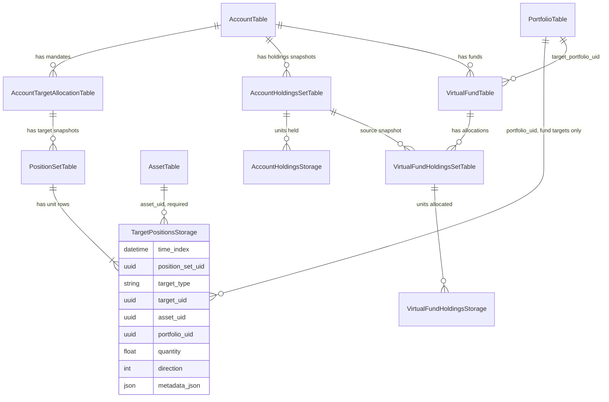

# 0052. Account Targets In Units

## Status

Proposed (2026-11-15). No issue has been filed for it yet. The decisions marked (owner)
were made by the owner on 2026-11-15. Implemented on `development` for 3.6.0, except the
examples listed under "Implementation Notes".

- It amends [ADR 0027](0027-account-target-position-portfolio-exposure.md): a portfolio
  target stores its constituents in units, and the value exposure columns are removed (see
  "Amendment To ADR 0027").
- It amends [ADR 0029](0029-account-holdings-virtual-fund-allocation-policy.md): the
  allocation reads unit targets, so its NAV calculation, target demand expansion and
  valuation resolver are removed (see "Amendment To ADR 0029").
- [ADR 0053](0053-virtual-fund-allocation-routes-and-described-policies.md), also a draft,
  is written on top of this ADR (see "Effect On ADR 0053").

## Context

### ms-markets is a record library

ms-markets records accounts, holdings, targets, portfolios and funds. Prices, and the rules
that turn a price into a position size, are always provided by the caller. A calculation
that needs market data belongs where the caller already has that data.

### How an account target is stored today

`TargetPositionsStorage` holds one row per target of a `PositionSet`, keyed by
`(time_index, position_set_uid, target_type, target_uid)`:

- an asset row names an asset, and a portfolio row names a portfolio;
- each row carries exactly one of `weight_notional_exposure` (a share of NAV),
  `constant_notional_exposure` (an amount) or `single_asset_quantity` (units);
- the planner refuses `single_asset_quantity` on a portfolio row.

ADR 0027 chose this deliberately: "The target-position table stores mandate intent. It does
not store expanded portfolio constituents." A portfolio row is expanded through the
portfolio's value weights (`PortfolioWeightsStorage.weight`) when a workflow needs
asset-level exposure.

### What that forces on the allocation

Account holdings are stored in units (`AccountHoldingsStorage.quantity`), and so are fund
holdings (`VirtualFundHoldingsStorage.allocated_quantity`). The only thing not in units is
the fund's target. The allocation therefore has to compute, on every run:

```text
fund units = account NAV × target share × portfolio weight ÷ price
```

That is the only reason the allocation path has a valuation resolver, a NAV and notionals.

### Why value targets do not work for every instrument

| Instrument | Turning a value target into units |
| --- | --- |
| Stock | Notional × weight ÷ price. It works, but the result changes whenever a price changes. |
| Future | A future has roughly no market value, so a value weight cannot describe the position. Sizing it needs the contract multiplier and an exposure rule. |
| Option | A weight could mean premium or delta-adjusted exposure. Turning it into contracts needs a pricing model and the multiplier. |

Every case needs prices and rules that ms-markets does not own. A unit count is the only
form that is unambiguous for every instrument: 1,000 shares, 12 futures contracts, 40 option
contracts.

### Value targets rebalance without a trade

With value targets, a price change alone moves units between funds. Take an account worth
1,000,000 with fund A at 50% (AAPL and MSFT, half each) and fund B at 30% (MSFT and JNJ, half
each). If MSFT rises 10% and nobody trades:

- the NAV becomes 1,030,000, so fund A's claim on AAPL grows from 1,000 to 1,030 shares;
- fund B's claim on JNJ grows from 750 to 772.5 shares, which is more than the 750 held, so
  fund B shows a JNJ shortfall.

A sleeve of an account does not behave like that. Its units change when someone sizes it or
trades, not when a price moves.

## Decision

### 1. Every account target row is in units (owner)

A target row holds a quantity in the asset's own unit: shares, contracts, bonds, or units of
a currency. `weight_notional_exposure` and `constant_notional_exposure` are removed from the
model, and `single_asset_quantity` becomes `quantity`, which is never null.

The quantity is positive and a `direction` column gives its side (owner), exactly as account
holdings and fund holdings are stored. Targets, holdings and fund holdings then have the same
shape, so the allocation converts no signs.

### 2. A fund's target is a unit basket

A portfolio target is no longer one row. It is one row per asset of the fund's basket: fund
A at "AAPL 1,000 and MSFT 500" is two rows that share the portfolio. The basket of a fund is
every row of one portfolio in one `PositionSet`.

### 3. The models

`AccountTargetAllocationTable` and `PositionSetTable` are unchanged. `TargetPositionsStorage`
becomes:

```text
TargetPositionsStorage
  time_index      NOT NULL  the target snapshot's time
  position_set_uid NOT NULL FK -> PositionSetTable.uid
  target_type     NOT NULL  "asset" | "portfolio"
  target_uid      NOT NULL  asset_uid for an asset target, portfolio_uid for a fund target
  asset_uid       NOT NULL  FK -> AssetTable.uid
  portfolio_uid   NULL      FK -> PortfolioTable.uid; set only for a fund target
  quantity        NOT NULL  units of the asset, always positive
  direction       NOT NULL  1 for long, -1 for short
  metadata_json   NULL      information only (decision 5)

index: (time_index, position_set_uid, target_type, target_uid, asset_uid)

checks:
  target_type = "asset"      -> portfolio_uid IS NULL     AND target_uid = asset_uid
  target_type = "portfolio"  -> portfolio_uid IS NOT NULL AND target_uid = portfolio_uid
  quantity > 0
  direction IN (1, -1)
```

- A zero row cannot exist. An asset that leaves a basket has no row.

- `asset_uid` is now required on every row, because every row is a quantity of one asset.
- The existing foreign keys keep their delete rules.
- `ck_target_positions_single_exposure` is removed with the columns it checked.



Targets, account holdings and fund holdings are now all in units. A fund's target and its
allocated holdings meet on the same pair: the portfolio and the asset.

### 4. Existing position sets are deleted (owner)

The migration deletes every existing `PositionSet` and its `TargetPositionsStorage` rows, so
that the new columns can be required from the first row.

- Old rows cannot be converted: turning a share of NAV into units needs historical prices,
  which ms-markets does not have.
- `AccountTargetAllocationTable` rows are kept, so each account keeps its mandate.
- Applied fund holdings are kept. No virtual-fund table references a position set; a fund's
  holdings set references the account's holdings snapshot.
- This is a one-time deletion decided by the owner. ADR 0049's rule that account history is
  not deleted row by row stays in force afterwards.

### 5. The basket is sized by the caller, at a sizing event

A fund's basket only needs to change when:

- the fund is sized: money goes into or out of the sleeve, or its share of the account
  changes;
- the portfolio rebalances: its composition changes.

At each event the caller computes the basket with its own prices and rules (multipliers,
deltas, lot sizes, rounding, FX) and writes a new `PositionSet` in units. ms-markets records
it and derives nothing.

- **The request belongs to the provider (owner).** "10,000 in this fund", a share of NAV, a
  risk budget or a delta exposure is a sizing request. The provider that takes the request
  stores it in its own tables, sizes the basket, and decides when to size it again.
  ms-markets receives units only, so a new kind of request changes nothing in ms-markets.
- **The caller writes the basket, not a scale factor.** Scaling a portfolio's book gives
  fractions such as 12.4 contracts, and rounding them is a rule ms-markets does not own. Not
  every portfolio has a unit book, and a book can change in a corrected replay, which would
  change past targets.
- **Traceability.** A row's `metadata_json` may record how the basket was sized: the scale
  factor, the time of the portfolio book it was scaled from, the mandate share, and a source
  note. ms-markets stores these and never reads them.
- **For a portfolio that has a unit book** (`PortfolioStateStorage`), the caller can read the
  book from ms-markets and scale it. The basket then differs from the book by one factor.

### 6. Where market data is needed

| Step | Needs market data | Who supplies it |
| --- | --- | --- |
| Portfolio construction and rebalance | Yes | Provided to the portfolio engine, as today |
| Sizing a fund's basket | Yes | The caller, at the sizing event |
| Allocating holdings to funds | No | |
| Valuing a fund or the account | Yes | The caller, when it reports |

### 7. The allocation reads units only

An allocation policy takes the account's holdings and each fund's basket, each read as
quantity times direction, and returns fills, the direct account sleeve, gaps and deficits in
units:

```python
def proportional_attribution(
    holdings: Mapping[AssetId, float],
    targets: Mapping[tuple[FundId, AssetId], float],
    *,
    quantity_tolerance: float = 1e-9,
) -> Allocation: ...
```

No NAV, price, valuation asset or notional enters or leaves it. A fund's fills change only
when the account's holdings or the fund's basket change.

### 8. What is removed

Nothing is kept for compatibility. Removed:

- the `weight_notional_exposure` and `constant_notional_exposure` columns, and every wire
  field, discovery column and request model that carries them;
- `expand_portfolio_target_positions` and its `PortfolioWeightResolver`, since a fund target
  is already asset-level;
- the `target_weight` and `weight_notional_exposure` branches of
  `Account.pretty_print_positions`, a display helper that labels a frame's position column.
  Holdings writes already accept units only;
- from the allocation: the valuation resolver, the NAV, the portfolio-target expander, and
  the notional fields of the plan.

Every doc, skill, test and example that names any of these is updated in the same change.

## Amendment To ADR 0027

| ADR 0027 | Replaced by |
| --- | --- |
| "The target-position table stores mandate intent. It does not store expanded portfolio constituents." | Decisions 1 and 2: a fund target stores its constituents in units |
| "Exposure Semantics": a portfolio row is expanded through portfolio weights on demand | Decision 5: the caller sizes the basket at a sizing event |
| The storage contract's three exposure columns and its index | Decision 3 |

ADR 0027's two target kinds, and its rule that a portfolio is never turned into an asset,
are kept.

## Amendment To ADR 0029

ADR 0029's "NAV Calculation" and "Target Demand Expansion", and the valuation resolver in its
"Inputs", are removed by decision 7. Its allocation formulas are unchanged, and they were
already written in quantities.

## Effect On ADR 0053

ADR 0053 is written on top of this ADR. Because every target is in units:

- its plan request is the position set, the valuation time and the policy, and the caller
  sends no market data;
- it has no requirements route, valuation body or notionals;
- its policies are functions of units.

## Not Verified

- The number of existing position sets in any deployment.

## Rejected Alternatives

### Keep value targets and let the caller convert at every allocation

The allocation would stay free of prices, but every run would need the caller's NAV and a
quantity per claim, and a fund's units would still move with every price change.

### A separate basket table next to the value rows

Two records of one target can disagree, and the value row would still not size a future or
an option.

### Store a scale factor and multiply the portfolio's unit book

See decision 5: rounding rules, portfolios without a unit book, and corrected replays.

### Convert the existing position sets

It needs historical prices and sizing rules that ms-markets does not have.

## Consequences

- Every position recorded for an account is in units: targets, holdings and fund holdings.
- Stocks, futures and options are handled the same way, with no instrument rule in
  ms-markets.
- The allocation needs no market data, and a price change alone no longer moves units
  between funds.
- A caller must size a basket and write a new target whenever a fund is resized or its
  portfolio rebalances.
- ms-markets cannot check that a basket matches its portfolio.
- Existing target history is deleted once.
- Breaking for every caller that writes or reads account targets.

## Implementation Plan

- [x] Migration, shipped by ms-markets: delete the position sets and their rows, then change
      `TargetPositionsStorage` to decision 3. PostgreSQL and SQLite.
- [x] Storage contract, frame validation and the snapshot write for unit rows, with a fund's
      basket written in the same transaction as its position set.
- [x] Wire contracts, the `add-target-positions` and `target-positions` routes, the
      portfolio's `account-targets` route, discovery columns, and the `MarketsClient` methods.
- [x] Removal of everything in decision 8.
- [ ] Implementation of ADR 0053 on unit targets.
- [x] Tests: storage contract, SQLite snapshot writes, routes, the migration, and the
      allocation examples, all with network access blocked.
- [x] Documentation: the accounts and virtual-funds knowledge pages, the account and
      portfolio route guides, the client page, tutorial 03, the account and portfolio
      workflow skills, and the changelog.
- [ ] Examples: the full account workflow with two funds of two assets that share one asset,
      one account asset in no fund, and a visible sizing event; and a second example that
      sizes a basket holding futures and options, with the multiplier and the rounding to
      whole contracts done by the caller.

## Implementation Notes

### 2026-11-15: 3.6.0

- **Migration 0024** deletes the position sets and their rows, then alters
  `ms_markets__targetpositionsts` in place: it drops the three exposure columns and the
  single-exposure check, adds `quantity` and `direction`, makes `asset_uid` required, and
  replaces the grain index with one that includes `asset_uid`. It was run on SQLite only.
  It has not been run on PostgreSQL or on a TimescaleDB hypertable.
- **Writes.** The snapshot write (one statement on PostgreSQL, one statement list on SQLite)
  writes `quantity` and `direction`. The SQLite path is tested end to end on the migrated
  schema; the PostgreSQL statement is checked as compiled SQL only.
- **Wire contracts.** A target row request carries `asset_uid`, `quantity` and `direction`;
  a portfolio row also carries `portfolio_uid`. `listPortfolioAccountTargets` answers one
  item per account with `asset_count`.
- **Planner.** It reads unit targets. Decision 8's removals are done, and
  `HoldingValuationInput` and `ValuationDiagnostic` became `AccountHoldingInput` and
  `AllocationDiagnostic`. The policy model, the plan statuses and the apply step are
  unchanged; ADR 0053 changes them.
- **Docs.** The accounts and virtual-funds knowledge pages, the account and portfolio route
  guides, the client page, tutorial 03 and the account and portfolio workflow skills
  describe unit targets. The valuation-resolver skill is replaced by
  `accounts/target_sizing`.
- **Examples.** The full account workflow sizes its targets in a visible sizing step and
  plans without any valuation. It still has one target sleeve. Not done yet: the two-fund
  reference case, and the example that sizes a basket holding futures and options. The
  full workflow needs a backend and was not run; its sizing step was run on its own.
