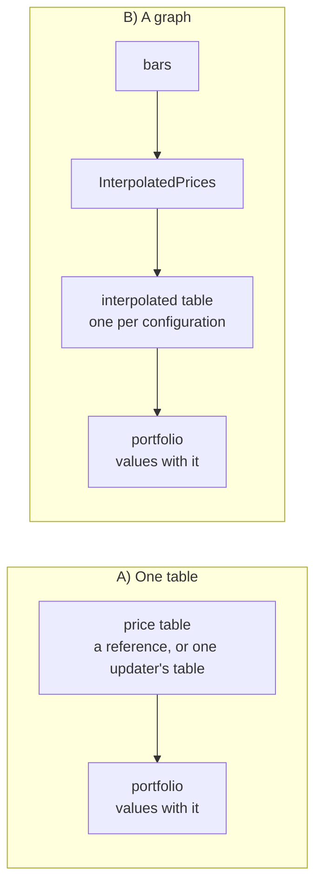
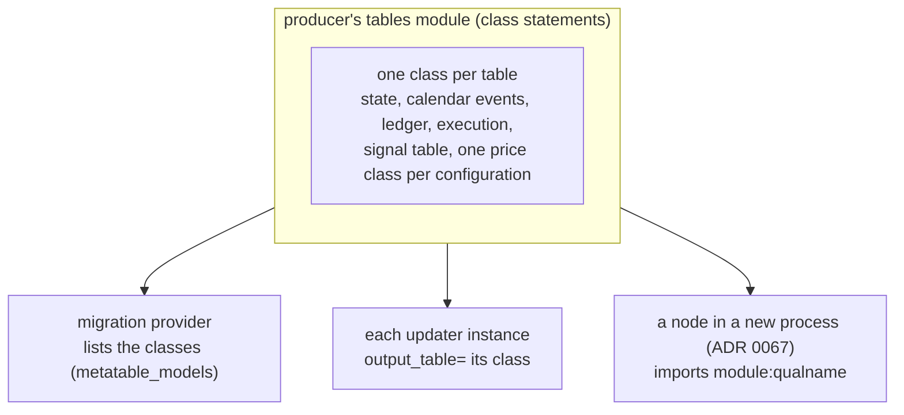

# 0066. A Producer Declares Its Tables As Classes

## Status

Accepted (2026-11-25), not yet implemented. Drafted at the owner's request on 2026-11-24, and
rebuilt on 2026-11-25 on
[#142](https://github.com/mainsequence-projects/MainSequenceMarkets/issues/142).

- **The owner's decisions.** The decisions marked (owner) are the owner's.
  - On 2026-11-24: no table is built on the fly, and a price source is one table or a graph.
  - On 2026-11-25: Markets declares its own tables (decision 6), a reader never declares
    another owner's table (decision 7), and a producer's tables are classes it declares,
    as #142 asks (decision 1).
- **What it replaces.** The first version of this ADR had producers declare their tables in a
  `TableCatalog` object and look them up by their settings. The owner withdrew that on
  2026-11-25: it duplicated MetaTables' migration provider, and a node's instance already
  carries everything about its table.
- **ADR 0060.** It extends ADR 0060 as amended for
  [#95](https://github.com/mainsequence-projects/MainSequenceMarkets/issues/95), which made a
  producer's tables predefined instances that its own provider migrates.
- **ADR 0067.** [ADR 0067](0067-portfolio-runs-in-parallel.md), on parallel runs, builds on
  it: a node in a new process imports its table class by the class's import address.

## Context

### What a producer's tables are

A producer writes its own instances of Markets' time-index contracts:
- rebalance state, calendar events and the event ledger of its portfolios;
- orders, order events and trades;
- its price tables;
- its computed signals' table (ADR 0060, amended on 2026-11-24);
- its index-value tables, one per cadence (ADR 0047, decision 4).

Each is declared on the producer's own base, in its namespace. It is created by a committed
revision of the producer's migration provider (ADR 0060, #95).

Today four factories make each instance's Python class:
- `configured_time_index_instance` (`src/msm/storage_instances.py`), for any core
  time-index storage;
- `configured_contract_instance_storage`, and the three `configured_portfolio_*_storage`
  factories over it (`src/msm_portfolios/time_index/contract_instances.py`), for the portfolio
  contracts;
- `configured_index_values_storage` with a namespace, storage app and base
  (`src/msm/time_index/indices/storage.py`), for index values.

Each one makes the class with `type()`. The class gets the factory's own module and a
generated name, which that module has no attribute for. The database table already exists,
because the producer's revision created it. The factory only makes the Python class.

### A price source is one table or a graph

A portfolio values its positions with `valuation_source_instance` (a `TimeIndexTableUpdater`
or a `TimeIndexTableRef`) and its `valuation_column`:

- **A) One table.**
  - A table another owner writes. The run only reads it, through a reference.
  - Or a table the producer writes with one updater, such as its bars.
- **B) A graph.** An updater reads another updater and writes its own table.
  - `InterpolatedPrices` reads bars and writes one table per configuration: the source table,
    its cadence, the upsample frequency and the rule (`interpolated_prices_instance_key`).
  - MetaTables runs the bars first, in the same run.
  - `InterpolatedPrices` refuses any table whose contract, key or cadence differs from what
    its configuration computes.



### How producers declare their tables today

On 2026-11-24 the producers in the workbench called the factories in two ways:

- **In one module, at import.** One producer builds every table when one module is imported.
  It keeps a dictionary with one interpolated-price table per bars profile, and a function
  that lists them all for its migration provider.
- **In cached functions.** The others build each table inside a function the first time some
  code asks for it.

### Tables ms-markets itself builds when asked

- **Markets' own index-value tables.** There is one per cadence,
  `ms_markets__index_values__t_<cadence>`, built by `configured_index_values_storage(cadence=...)`
  the first time a cadence is asked for. Markets' migrations create `ms_markets__indexvaluests`
  (revision `0018`) but list no per-cadence table.
- **A reader that builds another owner's table.** Markets' Index catalog, reading a table it
  discovered, builds a class for it (`_index_values_model`,
  `src/msm/services/indices/catalog.py`). For a provider's table it builds one with the
  provider's namespace and storage app on Markets' own base.

### What MetaTables decided

MetaTables 0.1.84 (2026-11-25) keeps a rule for running a node in a new process (MetaTables
ADR 0032; its issue 165 and pull request 166). The node imports its updater class and its
table classes by `module:qualname`, so it runs the owner's real classes: their columns,
foreign keys, class methods and attributes.

A class a function returns has no such address, and MetaTables refuses it before any node
starts:

```text
NodeRebuildError: Table class <CoreStorage>_<key>_<app> cannot be imported as
msm.storage_instances:<CoreStorage>_<key>_<app> by a node Job run. Declare it with a class
statement at the top level of a module of the repository: a class a function returns, or one
defined in the script that is run, has no import address.
```

MetaTables tried building a stand-in class from a table's registration, and dropped it: a
stand-in is not the owner's class. MetaTables then opened #142 on this repository. Markets
offers instances only through factories, so no producer's table can run in a node.

### What goes wrong today

- **A table appears only when some code asks for it.** Nothing in the code lists what a
  producer writes.
- **Another process can't find a table class again.** That is why MetaTables refuses it.
- **A table built from settings nobody migrated fails late.** It fails only when it is
  written.

## Decision

### 1. A producer declares each of its tables with a class statement (owner)

- **Where.** Each instance table is a `class` statement at the top level of a module of the
  producer's repository. It is not inside a function and not in the script that is run.
- **How it gets its contract.** The class inherits it from a Markets base class for the
  contract, plus the producer's own declarative base. Its own attributes give the instance
  key, the namespace, the storage app and, where the contract needs one, the cadence.
- **What it gets.** The declared class has the contract the factories give today:
  - the core storage's columns, time index and index names;
  - its foreign keys to Markets' registries;
  - the instance's identifier, namespace, storage app and cadence;
  - its extra hash components.
- **The address works.** Importing `<class.__module__>:<class.__qualname__>` in a new process
  returns the same class.
- **A dictionary is fine for lookup.** A producer may keep a dictionary keyed by
  configuration, for example one interpolated-price table per bars profile, when its values
  are classes declared this way.

```python
# my_provider/tables.py
class DailyInterpolatedPrices(InterpolatedPricesInstance, ProviderBase):
    __instance_key__ = interpolated_prices_instance_key(
        source_table_name=DailyBars.__table__.name,
        source_cadence="1d",
        upsample_frequency_id="1d",
        intraday_bar_interpolation_rule="ffill",
    )
    __metatable_namespace__ = "my-provider"
    __markets_storage_app__ = "my_provider"
    __cadence__ = "1d"


INTERPOLATED_PRICES_BY_PROFILE = {("1d", "sip", "all"): DailyInterpolatedPrices}
```

The base classes' names and attributes are the implementation's to settle. The sketch is
#142's.

### 2. The factories are removed (owner)

- **Removed.** `configured_time_index_instance`, `configured_contract_instance_storage` and
  its three `configured_portfolio_*_storage` factories, and the provider form of
  `configured_index_values_storage`.
- **No class at run time.** Nothing builds a table class while a run is going: not
  ms-markets' code, its examples, its docs or its skills.
- **No second form** is kept.

### 3. The same tables, unchanged

- **Same names.** A class declared with the same settings has the same physical table name,
  MetaTable identifier and DDL as the factory's class, so no migration changes for an
  existing table.
- **If it can't be done.** If that can't be achieved for every contract, the decision goes
  back to the owner before anything is released.

### 4. A price source is an instance or a table name (owner)

| Shape | What the producer declares | What the portfolio is given |
| --- | --- | --- |
| A, another owner's table | nothing | a reference by its physical name: `TimeIndexTableRef.from_physical_identity(schema=..., table_name=...)` |
| A, one updater's table | that table's class | the updater instance, whose `output_table=` is that class |
| B, a graph | a class per table of the graph it writes: its bars, if it writes them, and one interpolated-price class per configuration | the `InterpolatedPrices` instance, whose `output_table=` is the class for its configuration |

- **The instance carries everything.** An updater instance carries its class, its
  configuration, its output table class and its own dependencies. Nothing is looked up by an
  identifier or by settings.
- **A reference uses the physical name, not the UID.** The name is the same in every
  Environment, and the UID is not.
- **Wrong tables are still refused.** `InterpolatedPrices` and a computed signal keep refusing
  a table whose contract, key or cadence differs from their configuration.



### 5. The migration provider lists the classes

The producer's migration provider passes its declared classes as `metatable_models`. That is
MetaTables' own list of a producer's tables; ms-markets adds no other list.

### 6. Markets declares its own tables the same way (owner)

Markets is one more producer (ADR 0060, decision 5):
- Its per-cadence index-value tables are class statements in Markets' own module, created by
  Markets' own migrations.
- Which cadences exist is a declaration, never decided by the first request for one.
- A cadence Markets doesn't declare is refused.

### 7. A reader never declares another owner's table (owner)

A reader that discovers a table it doesn't own reads it through that table's registration and
declares nothing on its own base. Markets' Index catalog reading a provider's index values is
the case today.

The implementation shows whether the Index catalog's reads, which compile SQL against a
table's model, work from the registration alone. If they don't, this decision goes back to
the owner.

## Examples, Docs And Skills To Change

Each of these calls a factory, or tells the reader to.

- **Examples.**
  - `examples/msm_portfolios/portfolio_equal_weights_config.py`: `INTERPOLATED_PRICES_STORAGE`
    and `SIGNAL_WEIGHTS_STORAGE` become class statements, and
    `portfolio_equal_weights_migrations/__init__.py` lists the classes.
  - The index-value tables in `examples/msm/indices/plain_index_values.py`,
    `examples/msm/indices/extension_owned_index_storage.py` and
    `examples/msm/indices/delta_hedged_option_index.py`.
- **Skills** (`.agents/skills/ms_markets/`):
  - `portfolios/portfolio_workflow`;
  - `platform/producer_boundary`;
  - `platform/metatable_migrations`;
  - `accounts/execution_workflow`;
  - `indices/index_workflow`.
- **Docs.**
  - `docs/knowledge/msm_portfolios/portfolios/index.md`;
  - `docs/knowledge/msm/client/index.md`;
  - `docs/knowledge/msm/indices/index.md`;
  - `docs/knowledge/msm/indices/formula_indexes.md`;
  - `docs/tutorial/06-index-formulas.md`.
  - Any doc or ADR that shows a portfolio's table reference with `TimeIndexTableRef.from_uid`
    switches to the physical name.
- **Error messages that name a factory:**
  - `src/msm/time_index/indices/storage.py`;
  - `src/msm/time_index/indices/values.py`;
  - `src/msm_portfolios/contrib/prices/updaters.py`.
- **Tests.** The helpers in `tests/support/` that build instances, and the factories' own tests.

## Alternatives Considered

- **A `TableCatalog` object with a lookup by settings.** This was the first version of this
  ADR. Withdrawn by the owner on 2026-11-25: it duplicated MetaTables' migration provider, and
  a node's instance already carries everything about its table.
- **An import address passed to the factory** (`module=`, `name=`). Rejected by the owner on
  2026-11-24 as a hack: a factory would stamp a name the caller chose onto a class built at
  run time.
- **MetaTables building a stand-in class from a table's registration.** MetaTables tried it and
  dropped it: a stand-in is not the owner's class (MetaTables issue 165).
- **Keep building a table when it is first asked for.** Rejected by the owner. What a producer
  writes would stay known only from its code paths, and another process could not import its
  class.

## Consequences

- **One class per table.** A producer that keeps tables by configuration declares one class
  per configuration and keeps them in a dictionary. Each one already needs its own migration
  revision.
- **Breaking, in a minor release.** This is a breaking change shipped in a minor release,
  since no one uses ms-markets yet.
- **Documentation follows.** Every example, doc and skill in "Examples, Docs And Skills To
  Change" shows class statements.
- **ADR 0067 builds on it.** A node in a new process imports its table classes by their
  address. MetaTables 0.1.84 or later is required for that.

## Not Decided Here

- **The base classes.** The names of the base classes and of their attributes.
- **The Index catalog's reads.** Whether they can read a discovered table from its
  registration alone (decision 7).

## Not Verified

- **Unchanged tables.** That a class statement gives every contract's instance the same table
  name, identifier and DDL as its factory (decision 3).
- **Existing producers.** How many keep their tables in dictionaries keyed by configuration,
  which now need one class per entry.
- **Markets' own per-cadence tables.** How each one is created today. Markets' migrations
  don't list them, and this was not checked further.
