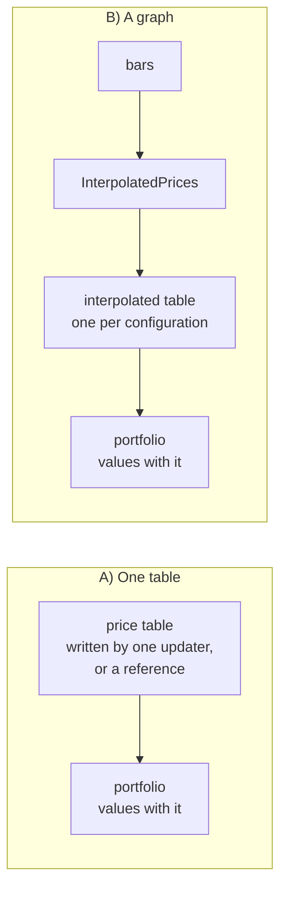
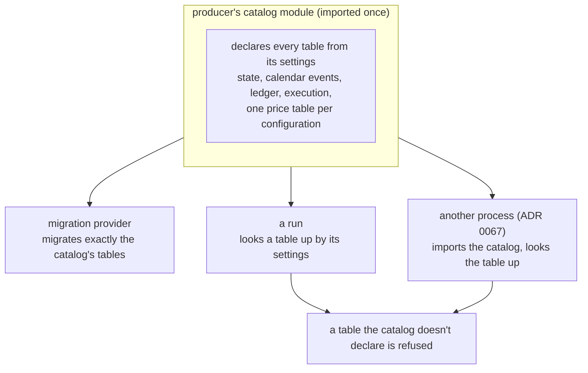

# 0066. A Producer Declares Its Tables In One Catalog

## Status

Proposed (2026-11-24). Drafted at the owner's request on 2026-11-24.

- **The owner's decisions.** The decisions marked (owner) were made by the owner that day.
  - One producer already declares its tables a certain way, and that way becomes the standard.
  - A run never builds a table on the fly.
  - A price source can be one table or a graph, and both follow the same rule.
- **ADR 0060.** It would extend
  [ADR 0060](0060-producers-publish-markets-reads-only-its-own-tables.md) as amended for
  [#95](https://github.com/mainsequence-projects/MainSequenceMarkets/issues/95). That
  amendment made an interpolated-price table a predefined instance keyed by its configuration
  and migrated by its producer.
- **ADR 0067.** [ADR 0067](0067-portfolio-runs-in-parallel.md) (portfolio runs in parallel)
  builds on it: a node Job run finds its output table through the producer's catalog.

## Context

### What a producer's tables are

A producer writes its own instances of Markets' time-index contracts:
- rebalance state, calendar events and the event ledger of its portfolios;
- orders, order events and trades;
- its price tables.

Each is declared on the producer's own base, in its namespace. It is created by a committed
revision of the producer's migration provider (ADR 0060, #95).

`configured_time_index_instance` and the `configured_portfolio_*_storage` builders make each
instance's Python class:
- **Made with `type()`.** The class gets the module `msm.storage_instances` and a generated
  name (`src/msm/storage_instances.py`).
- **Cached per settings.** The same settings always give the same class within a process.
- **The table already exists.** The database table exists because the producer's revision
  created it. The builder only makes the Python handle for it.

### A price source is one table or a graph

A portfolio values its positions with `valuation_source_instance` (a `TimeIndexTableUpdater`
or a `TimeIndexTableRef`) and its `valuation_column`. The source has one of two shapes:

- **A) One table.**
  - A reference to a table that already exists: the run only reads it, and the producer
    declares nothing.
  - Or an updater that writes one table, such as the producer's bars. That table is the
    producer's instance.
- **B) A graph.** An updater reads another and writes its own table.
  - `InterpolatedPrices` reads bars (an updater or a reference) and writes one table per
    configuration: the source table, its cadence, the upsample frequency and the rule
    (`interpolated_prices_instance_key`).
  - MetaTables runs the bars first, in the same run.
  - `InterpolatedPrices` computes its table's settings from its configuration and refuses
    any other table (`src/msm_portfolios/contrib/prices/updaters.py`).



### How producers declare their tables today

On 2026-11-24 the producers in the workbench declared their instances in two ways:

- **In one module, at import.**
  - One producer declares every table when one module is imported.
  - Its fixed tables share one key.
  - A dictionary holds one interpolated-price table per bars profile, built from each bars
    table's settings.
  - A function lists them all, and its migration provider migrates that list. A new bars
    profile gets its table in the revision that adds its bars.
- **In cached functions.** The others build each table inside a function the first time some
  code asks for it. Only the producer's migration revisions say which tables exist.

### What goes wrong without a standard

- **A table appears only when some code asks for it.** Nothing in the code lists what a
  producer writes.
- **Another process can't find a table again by its address.** The class carries a generated
  name in `msm.storage_instances`.
  - MetaTables' node Job mode, which runs a node in a new process (ADR 0067), finds a table
    that way.
  - On 2026-11-24 MetaTables' own check (`job_mode.node_arguments`) refused the equal-weights
    example's `InterpolatedPrices` for this reason.
- **A table built from settings nobody migrated fails late.** It fails only when it is
  written, not when it is declared.

## Decision

### 1. A producer declares every table it writes in one catalog (owner)

- **One catalog per producer.** It is a single module that declares every instance table the
  producer writes, from its settings, when the module is imported.
- **The catalog lists them.** The producer's migration provider migrates exactly that list.
- **New configurations.** A new price configuration, for example a new bars profile, is a
  new entry in the catalog and a new committed revision.

### 2. A run looks a table up and never builds one (owner)

- **By its settings.** ms-markets finds a table in the producer's catalog by its settings:
  the core storage, the instance key and the cadence.
- **Undeclared tables are refused.** A table the catalog doesn't declare is refused, with its
  settings in the message.
- **In any process.** The same lookup works in the producer's process and in any other
  process that imports the catalog.

### 3. The builders only declare

`configured_time_index_instance` and the `configured_portfolio_*_storage` builders become
the catalog's way of declaring a table. Nothing else calls them: not ms-markets' code, its
examples, its docs or its skills. No second form is kept.

### 4. Both price-source shapes follow it (owner)

| Shape | What the producer's catalog declares | How the run finds the table |
| --- | --- | --- |
| A, reference | nothing | reads the referenced table |
| A, updater | its one table | looks it up by its settings |
| B, graph | every table of the graph it writes: its bars, if it writes them, and one interpolated table per configuration it supports | looks up the interpolated table by the settings `InterpolatedPrices` computes from its configuration |



### 5. What stays as it is

- **Tables are unchanged.** A catalog declares the same tables, with the same settings, that
  the producers' revisions already created, so no table or update identity changes.
- **ADR 0060 stands.** Its rules on a producer's namespace, storage app and base, and on
  private tables, are unchanged.

## Worked Example

A producer's catalog, in outline. The names are the implementation's to settle (see Not
Decided Here).

```python
# my_project/tables.py: the producer's catalog
CATALOG = TableCatalog(namespace="my-project", storage_app="my_project", base=Base)

REBALANCE_STATE = CATALOG.declare(PortfolioRebalanceStateStorage, instance_key="main")
EVENT_LEDGER = CATALOG.declare(PortfolioEventLedgerStorage, instance_key="main")
INTERPOLATED_PRICES_BY_PROFILE = {
    profile: CATALOG.declare(
        InterpolatedPricesStorage,
        instance_key=interpolated_prices_instance_key(
            source_table_name=bars.__table__.name,
            source_cadence=bars.__cadence__,
            upsample_frequency_id="1d",
            intraday_bar_interpolation_rule="ffill",
        ),
        cadence="1d",
    )
    for profile, bars in BARS_BY_PROFILE.items()
}

# The producer's migration provider migrates CATALOG.tables().
# A run finds a table with CATALOG.find(InterpolatedPricesStorage, instance_key=..., cadence="1d");
# a table the catalog doesn't declare is refused.
```

## Alternatives Considered

- **An import address per table.** The builder would take `module=` and `name=` so each class
  imports from where it is declared. Rejected by the owner: it needs a constant for every
  table, while a producer's price tables come from settings, for example one per bars
  profile.
- **A registry inside `msm.storage_instances`.** It would answer a table by its generated
  name. Without a standard place where a producer declares its tables, nothing makes another
  process import the module that builds a table first, so the lookup can fail. The catalog
  is that standard place.
- **Keep building a table when it is first asked for.** Rejected by the owner. What a
  producer writes would stay known only from its code paths, and another process could not
  find a table again.

## Consequences

- **Producers move to catalogs.**
  - Producers that build tables in cached functions move them into their catalog.
  - A producer that already declares its tables in one module at import declares them
    through the catalog instead.
- **Breaking, in a minor release.** This is a breaking change shipped in a minor release,
  since no one uses ms-markets yet.
- **Documentation follows.** The example's configuration, the docs and the skills show the
  catalog. That covers the portfolio workflow, the producer boundary, migrations and the
  execution workflow.
- **ADR 0067 builds on it.** A node Job run imports the catalog and finds its output table
  by the settings in the node's saved configuration.

## Not Decided Here

- **The catalog's API.** The names and API: `TableCatalog`, `declare`, `find`, `tables`.
- **How `InterpolatedPrices` gets its table.** It could receive the catalog and look its
  table up itself, or receive the table the producer looked up.
- **The migration provider's side.** How a producer's migration provider takes the catalog's
  list.

## Not Verified

- **Moving existing producers.** That every producer's existing tables move into a catalog
  with no schema change. It is expected, since the settings are the same, but nothing has
  been moved.
