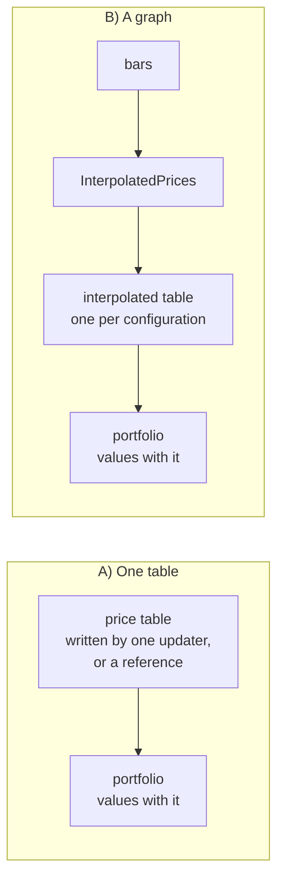
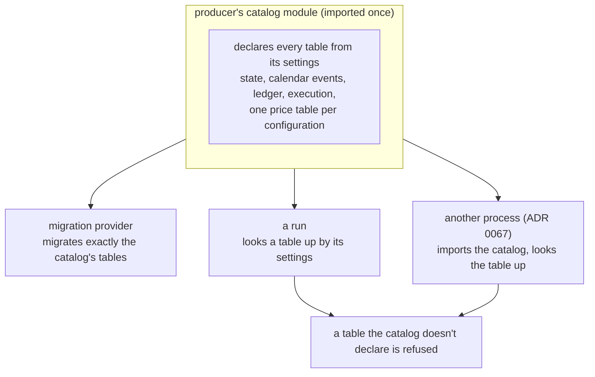

# 0066. A Producer Declares Its Tables In One Catalog

## Status

Accepted (2026-11-25), not yet implemented. Drafted at the owner's request on 2026-11-24.

- **The owner's decisions.** The decisions marked (owner) were made by the owner that day.
  - One producer already declares its tables a certain way, and that way becomes the standard.
  - A run never builds a table on the fly.
  - A price source can be one table or a graph, and both follow the same rule.
- **ADR 0060.** It would extend
  [ADR 0060](0060-producers-publish-markets-reads-only-its-own-tables.md) as amended for
  [#95](https://github.com/mainsequence-projects/MainSequenceMarkets/issues/95). That
  amendment made an interpolated-price table a predefined instance keyed by its configuration
  and migrated by its producer.
- **ADR 0067.** [ADR 0067](0067-portfolio-runs-in-parallel.md) (portfolio runs in parallel)
  builds on it: a node Job run finds its output table through the producer's catalog.
- **Scope completed (2026-11-25).** At the owner's request the scope was completed:
  - every table builder is named, the index-values one included;
  - Markets' own tables built on request, and a reader that builds another owner's table,
    are covered (decisions 6 and 7);
  - the catalog's shape is set (decision 8);
  - the examples, docs and skills to change are listed.

  The owner accepted decisions 6 to 8 on 2026-11-25.

## Context

### What a producer's tables are

A producer writes its own instances of Markets' time-index contracts:
- rebalance state, calendar events and the event ledger of its portfolios;
- orders, order events and trades;
- its price tables;
- its computed signals' table, which each signal node writes as it publishes the same rows
  to Markets (ADR 0060, amended on 2026-11-24);
- its index-value tables, one per cadence (ADR 0047, decision 4).

Each is declared on the producer's own base, in its namespace. It is created by a committed
revision of the producer's migration provider (ADR 0060, #95).

Four builders make each instance's Python class:
- `configured_time_index_instance` (`src/msm/storage_instances.py`), for any core
  time-index storage;
- `configured_contract_instance_storage`, and the three `configured_portfolio_*_storage`
  builders over it (`src/msm_portfolios/time_index/contract_instances.py`), for the
  portfolio contracts;
- `configured_index_values_storage` with a namespace, storage app and base
  (`src/msm/time_index/indices/storage.py`), for index values.

All four behave the same way:
- **Made with `type()`.** The class gets the module `msm.storage_instances` and a generated
  name (`src/msm/storage_instances.py`).
- **Cached per settings.** The same settings always give the same class within a process.
- **The table already exists.** The database table exists because the producer's revision
  created it. The builder only makes the Python handle for it.

### A price source is one table or a graph

A portfolio values its positions with `valuation_source_instance` (a `TimeIndexTableUpdater`
or a `TimeIndexTableRef`) and its `valuation_column`. The source has one of two shapes:

- **A) One table.**
  - A reference to a table that already exists: the run only reads it, and the producer
    declares nothing.
  - Or an updater that writes one table, such as the producer's bars. That table is the
    producer's instance.
- **B) A graph.** An updater reads another and writes its own table.
  - `InterpolatedPrices` reads bars (an updater or a reference) and writes one table per
    configuration: the source table, its cadence, the upsample frequency and the rule
    (`interpolated_prices_instance_key`).
  - MetaTables runs the bars first, in the same run.
  - `InterpolatedPrices` computes its table's settings from its configuration and refuses
    any other table (`src/msm_portfolios/contrib/prices/updaters.py`).



### How producers declare their tables today

On 2026-11-24 the producers in the workbench declared their instances in two ways:

- **In one module, at import.**
  - One producer declares every table when one module is imported.
  - Its fixed tables share one key.
  - A dictionary holds one interpolated-price table per bars profile, built from each bars
    table's settings.
  - A function lists them all, and its migration provider migrates that list. A new bars
    profile gets its table in the revision that adds its bars.
- **In cached functions.** The others build each table inside a function the first time some
  code asks for it. Only the producer's migration revisions say which tables exist.

### Tables ms-markets itself builds when asked

- **Markets' own index-value tables.** There is one per cadence,
  `ms_markets__index_values__t_<cadence>`, and `configured_index_values_storage(cadence=...)`
  builds the class for one the first time a cadence is asked for. Markets' migrations create
  `ms_markets__indexvaluests` (revision `0018`) but list no per-cadence table.
- **A reader that builds another owner's table.** Markets' Index catalog, reading a table it
  discovered, builds a class for it (`_index_values_model`,
  `src/msm/services/indices/catalog.py`). For a provider's table it builds one with the
  provider's namespace and storage app on Markets' own base.

### What goes wrong without a standard

- **A table appears only when some code asks for it.** Nothing in the code lists what a
  producer writes.
- **Another process can't find a table again by its address.** The class carries a generated
  name in `msm.storage_instances`.
  - MetaTables' node Job mode, which runs a node in a new process (ADR 0067), finds a table
    that way.
  - On 2026-11-24 MetaTables' own check (`job_mode.node_arguments`) refused the equal-weights
    example's `InterpolatedPrices` for this reason.
- **A table built from settings nobody migrated fails late.** It fails only when it is
  written, not when it is declared.

## Decision

### 1. A producer declares every table it writes in one catalog (owner)

- **One catalog per producer.** It is a single module that declares every instance table the
  producer writes, from its settings, when the module is imported.
- **The catalog lists them.** The producer's migration provider migrates exactly that list.
- **New configurations.** A new price configuration, for example a new bars profile, is a
  new entry in the catalog and a new committed revision.

### 2. A run looks a table up and never builds one (owner)

- **By its settings.** ms-markets finds a table in the producer's catalog by its settings:
  the core storage, the instance key and the cadence.
- **Undeclared tables are refused.** A table the catalog doesn't declare is refused, with its
  settings in the message.
- **In any process.** The same lookup works in the producer's process and in any other
  process that imports the catalog.

### 3. The builders only declare

The four builders (`configured_time_index_instance`, `configured_contract_instance_storage`
with its three `configured_portfolio_*_storage` builders, and `configured_index_values_storage`)
become the catalog's way of declaring a table. Nothing else calls them: not ms-markets' code,
its examples, its docs or its skills. No second form is kept.

### 4. Both price-source shapes follow it (owner)

| Shape | What the producer's catalog declares | How the run finds the table |
| --- | --- | --- |
| A, reference | nothing | reads the referenced table |
| A, updater | its one table | looks it up by its settings |
| B, graph | every table of the graph it writes: its bars, if it writes them, and one interpolated table per configuration it supports | looks up the interpolated table by the settings `InterpolatedPrices` computes from its configuration |



### 5. What stays as it is

- **Tables are unchanged.** A catalog declares the same tables, with the same settings, that
  the producers' revisions already created, so no table or update identity changes.
- **ADR 0060 stands.** Its rules on a producer's namespace, storage app and base, and on
  private tables, are unchanged.

### 6. Markets declares its own tables the same way (owner)

Markets is one more producer (ADR 0060, decision 5):
- Its per-cadence index-value tables are declared in Markets' own catalog and created by
  Markets' own migrations.
- Which cadences exist is a declaration, never decided by the first request for one.
- A cadence Markets doesn't declare is refused, like any undeclared table.

### 7. A reader never declares another owner's table (owner)

A reader that discovers a table it doesn't own reads it through that table's registration
and declares nothing on its own base. Markets' Index catalog reading a provider's index
values is the case today.

The implementation shows whether the Index catalog's reads, which compile SQL against a
table's model, work from the registration alone. If they don't, this decision goes back to
the owner.

### 8. The catalog's shape (owner)

- **Owner settings, once.** `TableCatalog(namespace=..., storage_app=..., base=...)` takes the
  producer's owner settings.
- **Declaring.**
  - `declare(core_storage, *, instance_key, cadence=None)` declares an instance of any core
    time-index storage, the three portfolio contracts and the signal table included.
  - `declare_index_values(cadence=...)` declares an index-value table, which is keyed by its
    cadence.
- **Finding.** `find(...)`, with the same settings, returns the declared table or refuses.
  `tables()` lists every declared table, in the order they were declared.
- **A node gets its table from its producer.**
  - `output_table=CATALOG.find(...)` for `InterpolatedPrices`, a computed signal and the
    calendar events.
  - `rebalance_output_table=` and `event_ledger_output_table=` for `run_portfolios`.
  - `InterpolatedPrices` and a computed signal keep refusing a table of another contract,
    key or cadence.
- **The migration provider lists the catalog.** It passes `CATALOG.tables()` as its
  `metatable_models`, as the equal-weights example's provider lists its two tables today.

## Worked Example

A producer's catalog, in outline, with the shape of decision 8.

```python
# my_project/tables.py: the producer's catalog
CATALOG = TableCatalog(namespace="my-project", storage_app="my_project", base=Base)

REBALANCE_STATE = CATALOG.declare(PortfolioRebalanceStateStorage, instance_key="main")
EVENT_LEDGER = CATALOG.declare(PortfolioEventLedgerStorage, instance_key="main")
INTERPOLATED_PRICES_BY_PROFILE = {
    profile: CATALOG.declare(
        InterpolatedPricesStorage,
        instance_key=interpolated_prices_instance_key(
            source_table_name=bars.__table__.name,
            source_cadence=bars.__cadence__,
            upsample_frequency_id="1d",
            intraday_bar_interpolation_rule="ffill",
        ),
        cadence="1d",
    )
    for profile, bars in BARS_BY_PROFILE.items()
}

SIGNAL_WEIGHTS = CATALOG.declare(SignalWeightsStorage, instance_key="signals")
DAILY_INDEX_VALUES = CATALOG.declare_index_values(cadence="1d")

# my_project/migrations/__init__.py: the provider migrates exactly the catalog's tables.
migration = build_metatable_migration_provider(..., metatable_models=CATALOG.tables())

# A node gets its table from the catalog; an undeclared one is refused.
prices = InterpolatedPrices(
    ...,
    output_table=CATALOG.find(InterpolatedPricesStorage, instance_key=..., cadence="1d"),
)
```

## Examples, Docs And Skills To Change

Each of these calls a builder outside a catalog, or tells the reader to.

- **Examples.**
  - `examples/msm_portfolios/portfolio_equal_weights_config.py`: `INTERPOLATED_PRICES_STORAGE`
    and `SIGNAL_WEIGHTS_STORAGE` become catalog declarations, and
    `portfolio_equal_weights_migrations/__init__.py` lists the catalog's tables.
  - The index-value tables in `examples/msm/indices/plain_index_values.py`,
    `examples/msm/indices/extension_owned_index_storage.py` and
    `examples/msm/indices/delta_hedged_option_index.py`.
- **Skills** (`.agents/skills/ms_markets/`):
  - `portfolios/portfolio_workflow`;
  - `platform/producer_boundary`;
  - `platform/metatable_migrations`;
  - `accounts/execution_workflow`;
  - `indices/index_workflow`.
- **Docs.**
  - `docs/knowledge/msm_portfolios/portfolios/index.md`;
  - `docs/knowledge/msm/client/index.md`;
  - `docs/knowledge/msm/indices/index.md`;
  - `docs/knowledge/msm/indices/formula_indexes.md`;
  - `docs/tutorial/06-index-formulas.md`.
- **Error messages that name a builder:**
  - `src/msm/time_index/indices/storage.py`;
  - `src/msm/time_index/indices/values.py`;
  - `src/msm_portfolios/contrib/prices/updaters.py`.
- **Tests.** The helpers in `tests/support/` that build instances, and the builders' own
  tests.

## Alternatives Considered

- **An import address per table.** The builder would take `module=` and `name=` so each class
  imports from where it is declared. Rejected by the owner: it needs a constant for every
  table, while a producer's price tables come from settings, for example one per bars
  profile.
- **A registry inside `msm.storage_instances`.** It would answer a table by its generated
  name. Without a standard place where a producer declares its tables, nothing makes another
  process import the module that builds a table first, so the lookup can fail. The catalog
  is that standard place.
- **Keep building a table when it is first asked for.** Rejected by the owner. What a
  producer writes would stay known only from its code paths, and another process could not
  find a table again.

## Consequences

- **Producers move to catalogs.**
  - Producers that build tables in cached functions move them into their catalog.
  - A producer that already declares its tables in one module at import declares them
    through the catalog instead.
- **Breaking, in a minor release.** This is a breaking change shipped in a minor release,
  since no one uses ms-markets yet.
- **Documentation follows.** Every example, doc and skill listed in "Examples, Docs And Skills
  To Change" shows the catalog.
- **ADR 0067 builds on it.** A node Job run imports the catalog and finds its output table
  by the settings in the node's saved configuration.

## Not Decided Here

- **The Index catalog's reads.** Whether they can read a discovered table from its
  registration alone (decision 7).

## Not Verified

- **Moving existing producers.** That every producer's existing tables move into a catalog
  with no schema change. It is expected, since the settings are the same, but nothing has
  been moved.
- **Markets' own per-cadence tables.** How each one is created today. Markets' migrations
  don't list them, and this was not checked further.
