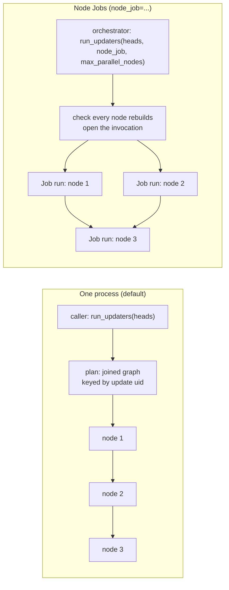
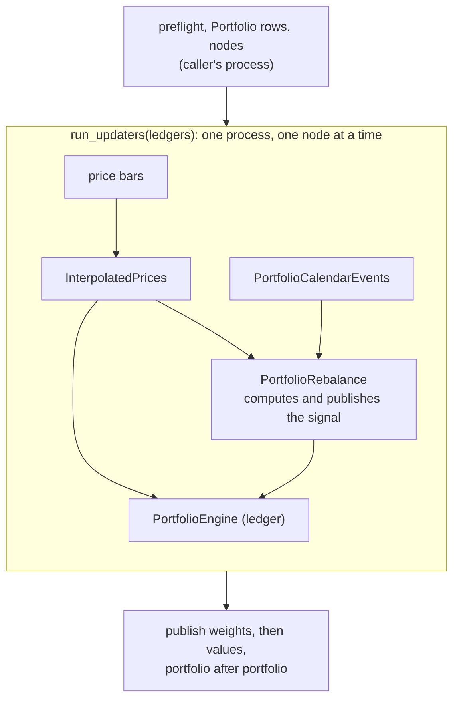
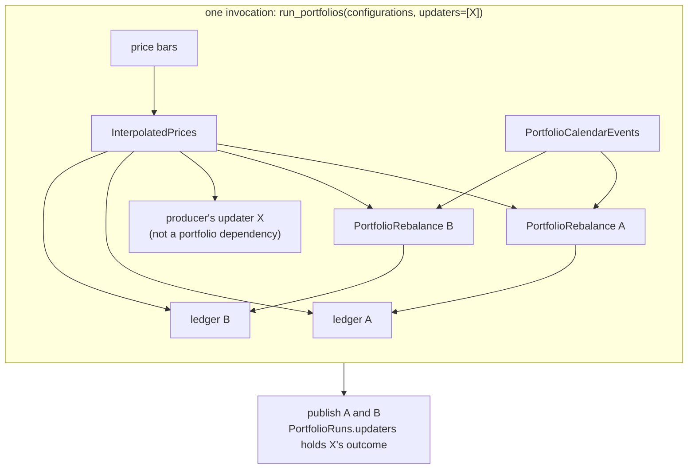
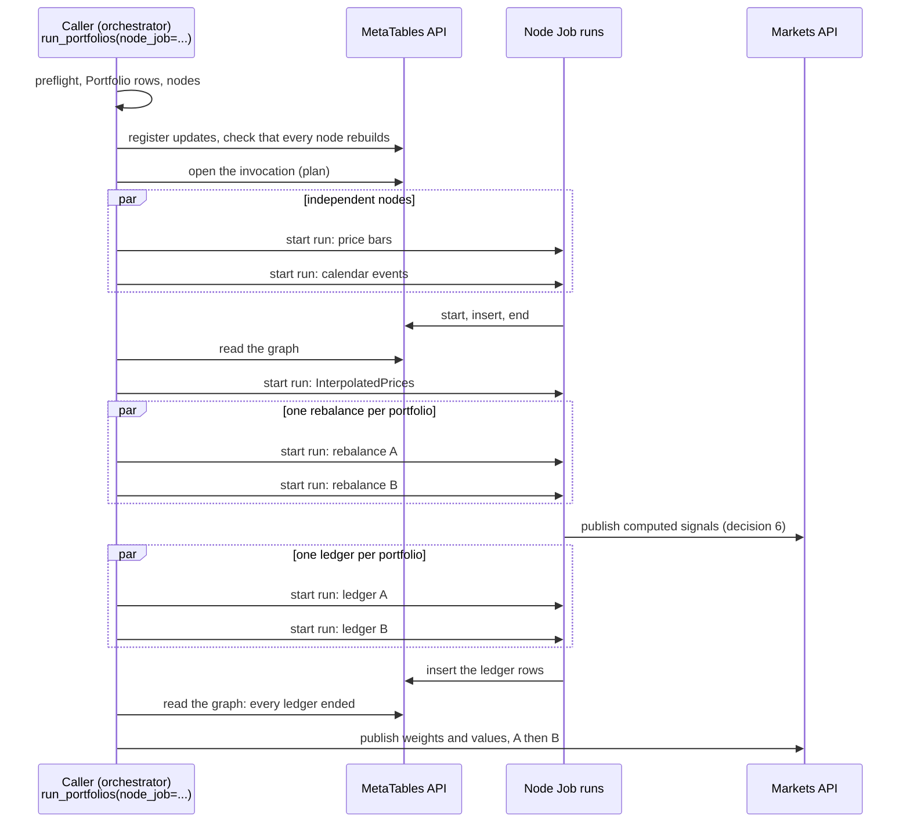

# 0066. Portfolio Runs In Parallel

## Status

Proposed (2026-11-24). Drafted at the owner's request on 2026-11-24, after an analysis of how
MetaTables 0.1.83 runs several updaters in one graph and in parallel. Nothing in it is decided.

- It builds on MetaTables ADR 0031 (several updaters run as one invocation) and MetaTables
  ADR 0032 (each node of an invocation runs in its own run of a node Job).
- It would extend `run_portfolios` as [ADR 0065](0065-every-portfolio-keeps-a-ledger.md)
  left it (decision 6 and the implementation note "one joined run").
- Decision 6 needs the owner: it touches the manager rule of
  [ADR 0060](0060-producers-publish-markets-reads-only-its-own-tables.md).

## Context

### What MetaTables offers

`run_updaters(updaters, update_tree=True, update_only_tree=False, node_job=None,
max_parallel_nodes=-1)` (`metatables/updaters/runner.py`, 0.1.83) joins the updaters' graphs
into one graph keyed by update uid.

- **Shared dependencies run once.** A dependency several updaters share runs once, and every
  node runs after its dependencies.
- **A failure stops only what needs it.** A failed node stops only the updaters that depend
  on it; each updater gets its own outcome.

The graph runs in one of two modes:

- **One process**, the default. Every node runs in the calling process, one after another.
  MetaTables has no threads.
- **Node Jobs** (`node_job="<Job name>"`, MetaTables ADR 0032).
  - The calling process orchestrates: it builds the plan, opens the invocation and starts
    one run of the node Job for each node whose dependencies have ended.
  - Independent nodes run at the same time, up to `max_parallel_nodes`.
  - Each node reports its start and end to the MetaTables API, and the orchestrator reads
    the graph. An outcome then carries no result.

Node Job mode has these requirements:

- **A hosted runtime.** A local runtime is refused.
- **A deployed node Job.** It is declared in the consuming repository's workflow file and
  deployed with a workload User. Its script calls `metatables.updaters.job_mode.run_updater_node()`.
  An orchestrator that sizes nodes (`TimeIndexTableUpdater.node_resources()`) needs
  `policy: sized_runner` on the Job.
- **Every node rebuilds in another process.**
  - The node Job run rebuilds each updater from its saved configuration.
  - Before anything starts, the orchestrator checks every node (`job_mode.node_arguments`):
    - the updater class and its output table class import as `module:qualname`;
    - every constructor argument rebuilds from its saved form;
    - the rebuilt update hash is the live one.
  - A node that fails the check stops the run before anything starts.



### What ms-markets does today

`run_portfolios` ([recipes.py](https://github.com/mainsequence-projects/MainSequenceMarkets/blob/development/src/msm_portfolios/recipes.py))
does three things, in the caller's process:

1. **Prepare each portfolio.** It runs the preflight, resolves the `Portfolio` row, builds
   the nodes and moves a first run's start to the signal.
2. **Run every ledger in one graph.** It calls `run_updaters(engines)` once, with no
   `node_job`, so the graph always runs in this process.
3. **Publish.** It publishes each portfolio's weights and values, one portfolio after another.



The rest of the current behaviour:

- **A producer's updaters join only as dependencies.** A valuation source, a signal's inputs
  or a strategy's inputs join the graph through `PortfolioRebalance.dependencies()`. Any
  other updater of the producer needs its own `run_updaters` call, so anything shared runs
  again there.
- **The per-run savings live in the process.**
  - These are one runtime lookup (#140), one read of each calendar (#137), and rows passed
    from node to node (#139).
  - They are context variables of the caller's process.
  - A node that finds nothing kept reads its tables itself, so results don't depend on them.

### What blocks a parallel run today

On 2026-11-24 MetaTables' own check (`job_mode.node_arguments`) ran on every node of the
equal-weights example's portfolio, ms-markets 6.1.0 on MetaTables 0.1.83. The check makes no
request:

| Node | Output table | Rebuilds in a node Job run |
| --- | --- | --- |
| `PortfolioEngine` | `PortfolioEventLedgerStorage` | No: its strategy's `calendar_events_instance` is a typed updater field, which the check can't validate ([MetaTables#164](https://github.com/mainsequence-projects/MetaTables/issues/164)) |
| `PortfolioRebalance` | `PortfolioRebalanceStateStorage` | No: the same |
| `InterpolatedPrices` | `msm.storage_instances:InterpolatedPricesStorage_022eb14e1d71b6a7_equal_weight_example` | No: the class isn't importable by that path |
| `PortfolioCalendarEvents` | `PortfolioCalendarEventsStorage` | Yes |
| The example's price bars | `ExternalPricesStorage` | Yes |

The rest of what blocks it:

- **Configured instance tables can't be imported.** `configured_time_index_instance` builds each
  instance with `type()`. It gives the class the module `msm.storage_instances` and a generated
  name that isn't an attribute of that module (`src/msm/storage_instances.py`). Every node that
  writes a configured instance is refused. That covers interpolated prices and any table a
  producer configures.
- **`run_portfolios` has no way to ask for node Jobs.** A producer that calls
  `run_updaters(engines, node_job=...)` itself has to redo the preflight, the start date and the
  publications, from private functions.
- **A computed signal published from a node Job would be refused.**
  - A node Job runs as the Job's workload User.
  - The Markets API refuses a publish whose caller isn't the series' manager
    (`manager_refusal`, `src/msm/api/managers.py`).
  - `PortfolioRebalance` publishes a computed signal inside its update, so in a node Job run
    that publish is the workload User's.

## Decision

All proposed.

### 1. `run_portfolios` takes MetaTables' run settings

`run_portfolios` and `run_portfolio` take `node_job: str | None = None` and
`max_parallel_nodes: int = -1` and pass them to `run_updaters` unchanged.

- The default is one process, as today.
- A run setting is not part of any configuration or update hash, so no identity changes.

### 2. `run_portfolios` runs a producer's own updaters in the same graph

`run_portfolios` takes `updaters: Sequence[TimeIndexTableUpdater] = ()`.

- **Same graph.** They are heads of the same invocation as the ledgers, so a dependency they
  share with a portfolio runs once for both.
- **Their outcomes come back.** Each one's MetaTables outcome is in `PortfolioRuns.updaters`,
  in the order given.
- **Failures stay contained.** One that fails stops only what needs it (MetaTables ADR 0031).
  A portfolio whose ledger ran is still published.



### 3. A configured instance table is importable where it is declared

`configured_time_index_instance` takes the declaring module and the name the module gives the
instance:

```python
INTERPOLATED_PRICES_STORAGE = configured_time_index_instance(
    InterpolatedPricesStorage,
    instance_key=...,
    namespace=PROVIDER_NAMESPACE,
    storage_app=PROVIDER_STORAGE_APP,
    base=ProviderBase,
    module=__name__,
    name="INTERPOLATED_PRICES_STORAGE",
)
```

- **Importable.** The class gets them as `__module__` and `__qualname__`, so
  `module:name` imports to the same class in a node Job run.
- **Required, everywhere.** Both are required, since an instance without them can't run in a
  node Job. Every call in ms-markets, its examples, docs and skills passes them, with no
  default and no second form.
- **Identity unchanged.** A table's identity comes from its storage, instance key, namespace
  and app, not from its class name. This is expected; the implementation verifies it.

### 4. Every node a portfolio run builds rebuilds in a node Job run

Once MetaTables#164 is fixed, `node_arguments` passes for every updater `run_portfolios` puts
in the graph:

- `PortfolioEngine`;
- `PortfolioRebalance`;
- `PortfolioCalendarEvents`;
- `InterpolatedPrices`;
- the declared inputs of the strategies and signals ms-markets ships.

A test runs that check on a portfolio graph, so a change that breaks it fails in CI. The check
stops at the first argument it can't rebuild, so what it finds after #164 isn't known yet. It
is fixed under this decision.

### 5. ms-markets ships the node Job's entry point

A producer's node Job script calls one ms-markets function. It attaches the Markets runtime
the nodes need, then runs MetaTables' `run_updater_node()`. If a bare `run_updater_node()`
turns out to be enough, this decision is documentation only.

### 6. A computed signal published from a node Job (owner)

In a node Job run, `PortfolioRebalance` publishes a computed signal as the node Job's
workload User. The options:

- **(a) The workload User manages the signal.**
  - In node Job mode, the producer's node Job workload User is the manager of the
    portfolios' computed signals. An Organization admin assigns it with `assign_manager`.
  - `run_portfolios` checks this before anything starts, and refuses with the fix.
  - Recommended: it needs no new Markets capability.
- **(b) The caller publishes the signal.** The signal stays computed in the rebalance, but
  the caller publishes it. Not possible: a node Job outcome carries no result, so the
  weights can't come back to the caller.
- **(c) The node acts for the caller.** The workload User publishes on behalf of the
  orchestrator's caller. That would be a new platform and Markets capability. Not available
  today (not verified).

### 7. What stays as it is

- **Publishing.** The weights and values are published after the graph, in the caller's
  process, one portfolio after another. When a ledger ran in a node Job run, they read its
  table.
- **Per-run savings.** They stay per process. A node in its own Job run reads its tables
  itself, and the results are the same.
- **The default.** One process stays the default.

## The New Capabilities

### A parallel portfolio run



### What runs where

| Step | One process (default) | Node Jobs |
| --- | --- | --- |
| Preflight, `Portfolio` rows, nodes | caller | caller (orchestrator) |
| Check that every node rebuilds | not needed | caller, before anything starts |
| Price bars, prices, calendar events | caller, one after another | one Job run each, at the same time when independent |
| Rebalance (and computed signal) | caller | one Job run per portfolio |
| Ledger | caller | one Job run per portfolio |
| Weights and values | caller | caller, reading each ledger's table |
| Per-run savings (#137, #139, #140) | whole run | inside each Job run only |

## Worked Example

Two portfolios, A and B, share the interpolated prices and the calendar events. The producer
also has an updater X that reads the prices.

- **Today.** `run_portfolios([A, B])` runs 7 nodes one after another: bars, prices, calendar
  events, rebalance A, rebalance B, ledger A, ledger B. X needs its own `run_updaters` call,
  which runs the bars and prices again.
- **With decisions 1 to 6.** `run_portfolios([A, B], updaters=[X], node_job="nodes",
  max_parallel_nodes=4)` runs 8 nodes in one invocation.
  - The bars and the calendar events start together.
  - The prices start when the bars end.
  - Rebalance A, rebalance B and X start together when the prices end. (The rebalances
    also wait for the calendar events.)
  - Each ledger starts when its rebalance ends.
  - The caller then publishes A's and B's weights and values.
- **How long.** The longest chain (bars, prices, rebalance, ledger) sets the run's length,
  not the number of portfolios. This is the expected order; MetaTables starts a node as soon
  as its dependencies end.

## Alternatives Considered

- **Threads in one process.**
  - MetaTables runs one process's nodes one after another, so threads would be MetaTables'
    to add.
  - ms-markets' per-run savings are context variables, which a new thread doesn't inherit.
- **A registry of instance tables in `msm.storage_instances`.** A module `__getattr__` would
  answer an instance by its generated name. A node Job run only finds an instance after its
  declaring module has been imported, and nothing in the run imports it, so the lookup can
  fail.
- **Producers call `run_updaters` themselves.** Each would redo the preflight, the start date
  and the publications from private functions of `run_portfolios`.

## Consequences

- **The default doesn't change.** Without `node_job`, a run is what it is today. No
  configuration or update identity changes.
- **Every caller of `configured_time_index_instance` changes** (decision 3). This is a breaking
  change in a minor release, since no one uses ms-markets yet.
- **A producer that uses node Jobs needs deployment work:**
  - a hosted runtime;
  - a node Job declared in its workflow file and deployed;
  - `policy: sized_runner` if nodes set their size;
  - grants for the node Job's workload User on the producer's tables and on Markets;
  - the signal managers of decision 6.
- **Each node Job run is its own process.** It looks up its runtime and reads its calendar
  and its tables itself. The per-run savings apply inside one Job run only.

## Not Decided Here

- **Publishing in parallel or in one call.** Whether the weights and values of several
  portfolios are published in parallel or in one Markets call. The owner's question about
  writing everything at the end of a run is open.
- **Node sizes.** The sizes ms-markets' nodes declare (`node_resources()`), if any.

## Not Verified

- **Node Job mode end to end.** It needs a hosted runtime; only the rebuild check ran.
- **The rest of the rebuild check.** What `node_arguments` finds in `PortfolioEngine` and
  `PortfolioRebalance` after MetaTables#164 is fixed.
- **The runtime in a node Job run.** Whether a node Job run needs the Markets runtime
  attached before `run_updater_node()` (decision 5).
- **The signal refusal.** That a node Job's publish of a computed signal is refused was
  read in `manager_refusal`, not run.
