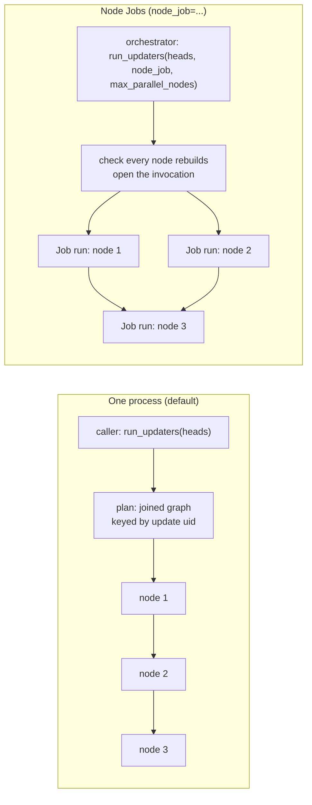
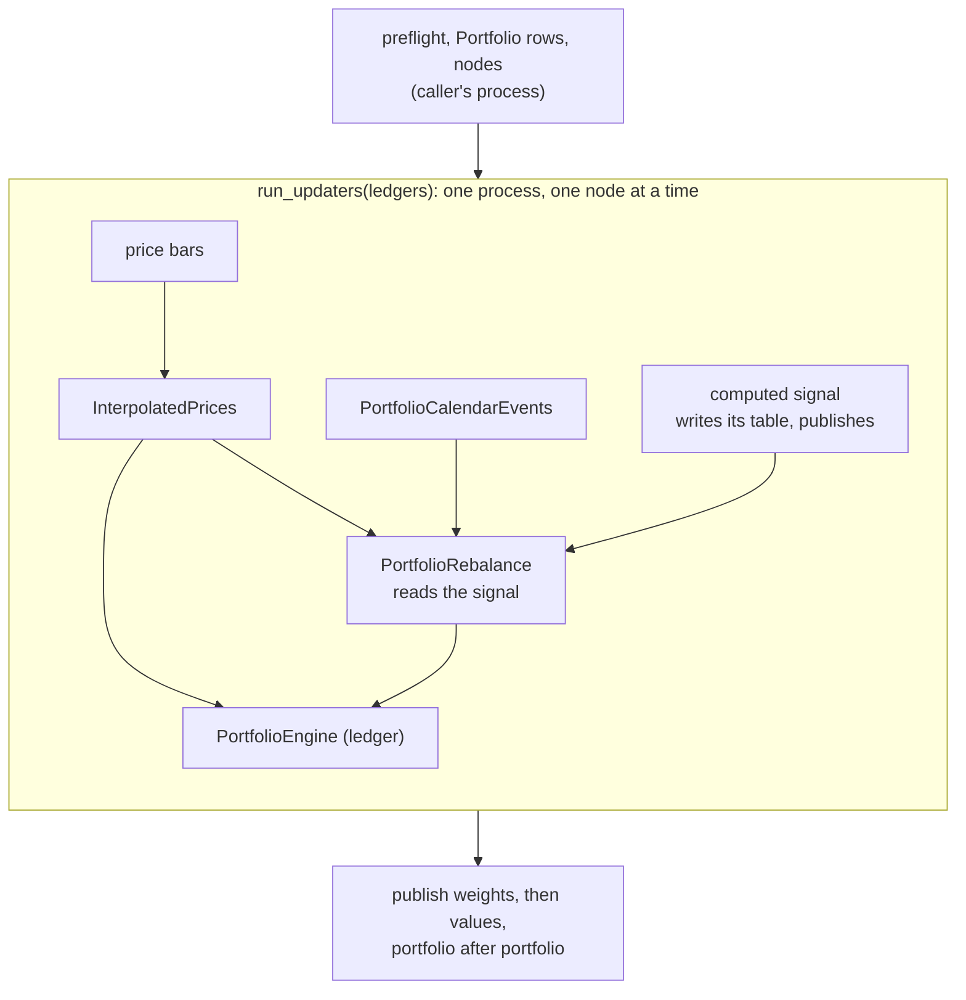
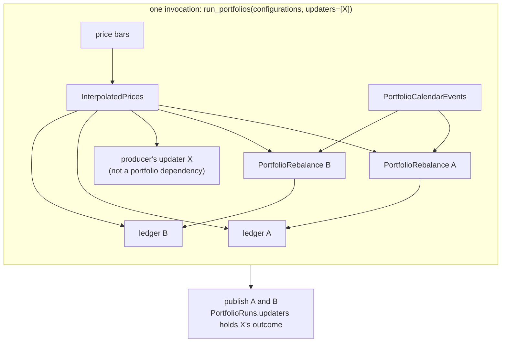
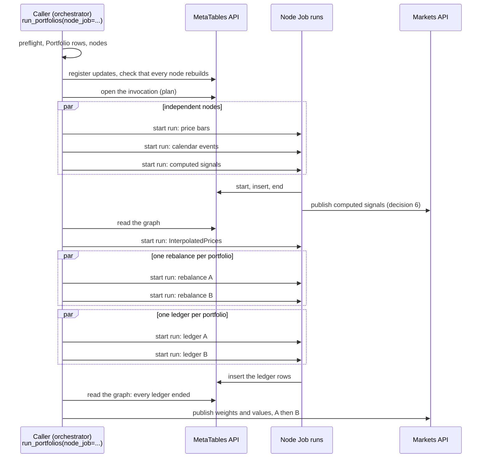

# 0067. Portfolio Runs In Parallel

## Status

Accepted (2026-11-25) and implemented for 6.2.0: see "Implementation Notes". Drafted at the
owner's request on 2026-11-24, after an analysis of how MetaTables 0.1.83 runs several updaters
in one graph and in parallel; the owner asked for its implementation on 2026-11-25.

- It builds on MetaTables ADR 0031 (several updaters run as one invocation) and MetaTables
  ADR 0032 (each node of an invocation runs in its own run of a node Job).
- It would extend `run_portfolios` as [ADR 0065](0065-every-portfolio-keeps-a-ledger.md)
  left it (decision 6 and the implementation note "one joined run").
- Decision 3 rests on [ADR 0066](0066-a-producer-declares-its-tables-as-classes.md):
  a producer declares each of its tables with a class statement, which a node in a new
  process imports by its address. MetaTables 0.1.84 requires that (its issue 165).
- Decision 6 was left to the owner: it touches the manager rule of
  [ADR 0060](0060-producers-publish-markets-reads-only-its-own-tables.md). The owner decided
  on 2026-11-24 that a computed signal is its own node (ADR 0060, amended for decisions 2
  and 5). The code answers who publishes it from a node Job run, so it needs no new rule
  (decision 6).

## Context

### What MetaTables offers

`run_updaters(updaters, update_tree=True, update_only_tree=False, node_job=None,
max_parallel_nodes=-1)` (`metatables/updaters/runner.py`, 0.1.83) joins the updaters' graphs
into one graph keyed by update uid.

- **Shared dependencies run once.** A dependency several updaters share runs once, and every
  node runs after its dependencies.
- **A failure stops only what needs it.** A failed node stops only the updaters that depend
  on it; each updater gets its own outcome.

The graph runs in one of two modes:

- **One process**, the default. Every node runs in the calling process, one after another.
  MetaTables has no threads.
- **Node Jobs** (`node_job="<Job name>"`, MetaTables ADR 0032).
  - The calling process orchestrates: it builds the plan, opens the invocation and starts
    one run of the node Job for each node whose dependencies have ended.
  - Independent nodes run at the same time, up to `max_parallel_nodes`.
  - Each node reports its start and end to the MetaTables API, and the orchestrator reads
    the graph. An outcome then carries no result.

Node Job mode has these requirements:

- **A hosted runtime.** A local runtime is refused.
- **A deployed node Job.** It is declared in the consuming repository's workflow file and
  deployed with a workload User. Its script calls `metatables.updaters.job_mode.run_updater_node()`.
  An orchestrator that sizes nodes (`TimeIndexTableUpdater.node_resources()`) needs
  `policy: sized_runner` on the Job.
- **Every node rebuilds in another process.**
  - The node Job run rebuilds each updater from its saved configuration.
  - Before anything starts, the orchestrator checks every node (`job_mode.node_arguments`):
    - the updater class and its output table class import as `module:qualname`;
    - every constructor argument rebuilds from its saved form;
    - the rebuilt update hash is the live one.
  - A node that fails the check stops the run before anything starts.



### What ms-markets does today

`run_portfolios` ([recipes.py](https://github.com/mainsequence-projects/MainSequenceMarkets/blob/development/src/msm_portfolios/recipes.py))
does three things, in the caller's process:

1. **Prepare each portfolio.** It runs the preflight, resolves the `Portfolio` row, builds
   the nodes and moves a first run's start to the signal.
2. **Run every ledger in one graph.** It calls `run_updaters(engines)` once, with no
   `node_job`, so the graph always runs in this process.
3. **Publish.** It publishes each portfolio's weights and values, one portfolio after another.



The rest of the current behaviour:

- **A producer's updaters join only as dependencies.** A valuation source, a computed signal
  (with its own inputs) or a strategy's inputs join the graph through
  `PortfolioRebalance.dependencies()`. Any
  other updater of the producer needs its own `run_updaters` call, so anything shared runs
  again there.
- **The per-run savings live in the process.**
  - These are one runtime lookup (#140), one read of each calendar (#137), and rows passed
    from node to node (#139).
  - They are context variables of the caller's process.
  - A node that finds nothing kept reads its tables itself, so results don't depend on them.

### What blocks a parallel run today

On 2026-11-24 MetaTables' own check (`job_mode.node_arguments`) ran on every node of the
equal-weights example's portfolio, ms-markets 6.1.0 on MetaTables 0.1.83. The check makes no
request:

| Node | Output table | Rebuilds in a node Job run |
| --- | --- | --- |
| `PortfolioEngine` | `PortfolioEventLedgerStorage` | No: its strategy's `calendar_events_instance` is a typed updater field, which the check couldn't validate. Fixed in MetaTables 0.1.84 ([MetaTables#164](https://github.com/mainsequence-projects/MetaTables/issues/164)), not re-checked here. |
| `PortfolioRebalance` | `PortfolioRebalanceStateStorage` | No: the same |
| `InterpolatedPrices` | `msm.storage_instances:InterpolatedPricesStorage_022eb14e1d71b6a7_equal_weight_example` | No: the class isn't importable by that path |
| `PortfolioCalendarEvents` | `PortfolioCalendarEventsStorage` | Yes |
| The example's price bars | `ExternalPricesStorage` | Yes |

The rest of what blocks it:

- **Configured instance tables can't be found by address.**
  `configured_time_index_instance` makes each instance's Python class with `type()`, under the
  module `msm.storage_instances` and a generated name that isn't an attribute of that module.
  So every node that writes a configured instance is refused. The table itself is predefined
  and migrated by its producer. MetaTables keeps the rule that a node imports its table
  classes by address, and opened
  [#142](https://github.com/mainsequence-projects/MainSequenceMarkets/issues/142).
  [ADR 0066](0066-a-producer-declares-its-tables-as-classes.md) makes producers declare such
  tables as classes.
- **`run_portfolios` has no way to ask for node Jobs.** A producer that calls
  `run_updaters(engines, node_job=...)` itself has to redo the preflight, the start date and the
  publications, from private functions.
- **Who publishes a computed signal from a node Job run.**
  - A computed signal's node publishes its new rows inside its update.
  - The Markets API refuses a publish whose caller isn't the series' manager
    (`manager_refusal`, `src/msm/api/managers.py`).
  - The 2026-11-24 draft took the caller to be the node Job's workload User, so the publish
    would be refused. Decision 6 corrects that: the caller is the branch.

## Decision

Accepted on 2026-11-25.

### 1. `run_portfolios` takes MetaTables' run settings

`run_portfolios` and `run_portfolio` take `node_job: str | None = None` and
`max_parallel_nodes: int = -1` and pass them to `run_updaters` unchanged.

- The default is one process, as today.
- A run setting is not part of any configuration or update hash, so no identity changes.

### 2. `run_portfolios` runs a producer's own updaters in the same graph

`run_portfolios` takes `updaters: Sequence[TimeIndexTableUpdater] = ()`.

- **Same graph.** They are heads of the same invocation as the ledgers, so a dependency they
  share with a portfolio runs once for both.
- **Their outcomes come back.** Each one's MetaTables outcome is in `PortfolioRuns.updaters`,
  in the order given.
- **Failures stay contained.** One that fails stops only what needs it (MetaTables ADR 0031).
  A portfolio whose ledger ran is still published.



### 3. A node in a new process imports its table classes

- **Every table is a class.** Per [ADR 0066](0066-a-producer-declares-its-tables-as-classes.md),
  each producer table is a class statement in the producer's module.
- **MetaTables imports it.** MetaTables 0.1.84 imports a node's output table class, and the
  table of any updater passed as an argument, by `module:qualname` (MetaTables ADR 0032, issue
  165), so the node runs the producer's real classes.
- **ms-markets adds nothing.** It needs no lookup of its own: the updater instance carries its
  table class.

### 4. Every node a portfolio run builds rebuilds in a node Job run

With ms-markets on MetaTables 0.1.84, which fixes #164, and with ADR 0066's classes,
`node_arguments` passes for every updater `run_portfolios` puts in the graph:

- `PortfolioEngine`;
- `PortfolioRebalance`;
- `PortfolioCalendarEvents`;
- `InterpolatedPrices`;
- the computed signals ms-markets ships;
- the declared inputs of the strategies and signals ms-markets ships.

A test runs that check on a portfolio graph, so a change that breaks it fails in CI. The check
stops at the first argument it can't rebuild, so what it finds after #164 isn't known yet. It
is fixed under this decision.

What it found, and how it was fixed, is in "Implementation Notes":

- **The signal.** A rebalance saves a computed signal by its update and a published one as its
  pydantic model, which MetaTables rebuilds. A portfolio's identity still names its signal by
  its `signal_uid`.
- **The portfolio.** A rebalance saves its portfolio's identifier outside its hash, so a
  rebuilt one needs no resolver.

### 5. ms-markets ships the node Job's entry point

A producer's node Job script calls one ms-markets function, `msm_portfolios.node_job.run_node()`.
It runs MetaTables' `run_updater_node()`, which imports the node's classes itself, inside the
per-run scopes `run_portfolios` gives its nodes: one runtime lookup (#140), one read of each
calendar (#137) and the rows a node keeps (#139). Nothing else needs attaching: the Markets
backend is the Job's setting, as for any producer Job.

```python
# jobs/run_updater_node.py, in the producer's repository
from msm_portfolios.node_job import run_node

if __name__ == "__main__":
    run_node()
```

### 6. A node Job run publishes a computed signal as its branch

The owner decided on 2026-11-24 that a computed signal is its own node of the portfolio DAG
([ADR 0060](0060-producers-publish-markets-reads-only-its-own-tables.md), amended for
decisions 2 and 5): its update writes the producer's own signal table and publishes the new
rows to Markets, and the rebalance only reads the table. Who publishes it from a node Job run
was left open. The code answers it, and nothing new is needed:

- **The caller is the branch.** Markets records and checks a row's manager as the caller's
  principal (`caller_principal`, `apps/v1/identity.py`). A workload User declared on a code
  repository branch is `branch:<branch uid>`: every Job, release and Agent of one application
  in one Environment.
- **The same manager.** A node Job is a Job of the producer's branch, as the Job that calls
  `run_portfolios` is. A node Job run publishes a computed signal as the manager that created
  its `SignalMetadata` row when a Job of the branch created it.
- **A signal a person created.** One created by a person (`user:<uid>`), say from a laptop
  against the hosted Markets, is refused in a node Job run as in any Job. An Organization admin
  assigns it to the branch (`msm registry assign-manager`), as ADR 0060 already says.

This was read in the code, not run on a hosted runtime.

### 7. What stays as it is

- **Publishing.** The weights and values are published after the graph, in the caller's
  process, one portfolio after another. When a ledger ran in a node Job run, they read its
  table.
- **Per-run savings.** They stay per process. A node in its own Job run reads its tables
  itself, and the results are the same.
- **The default.** One process stays the default.

## The New Capabilities

### A parallel portfolio run



### What runs where

| Step | One process (default) | Node Jobs |
| --- | --- | --- |
| Preflight, `Portfolio` rows, nodes | caller | caller (orchestrator) |
| Check that every node rebuilds | not needed | caller, before anything starts |
| Price bars, prices, calendar events | caller, one after another | one Job run each, at the same time when independent |
| Computed signal | caller | one Job run per signal |
| Rebalance | caller | one Job run per portfolio |
| Ledger | caller | one Job run per portfolio |
| Weights and values | caller | caller, reading each ledger's table |
| Per-run savings (#137, #139, #140) | whole run | inside each Job run only |

## Worked Example

Two portfolios, A and B, share the interpolated prices and the calendar events. Their
signals are published ones, so they add no node. The producer also has an updater X that
reads the prices.

- **Today.** `run_portfolios([A, B])` runs 7 nodes one after another: bars, prices, calendar
  events, rebalance A, rebalance B, ledger A, ledger B. X needs its own `run_updaters` call,
  which runs the bars and prices again.
- **With decisions 1 to 6.** `run_portfolios([A, B], updaters=[X], node_job="nodes",
  max_parallel_nodes=4)` runs 8 nodes in one invocation.
  - The bars and the calendar events start together.
  - The prices start when the bars end.
  - Rebalance A, rebalance B and X start together when the prices end. (The rebalances
    also wait for the calendar events.)
  - Each ledger starts when its rebalance ends.
  - The caller then publishes A's and B's weights and values.
- **How long.** The longest chain (bars, prices, rebalance, ledger) sets the run's length,
  not the number of portfolios. This is the expected order; MetaTables starts a node as soon
  as its dependencies end.

## Alternatives Considered

- **Threads in one process.**
  - MetaTables runs one process's nodes one after another, so threads would be MetaTables'
    to add.
  - ms-markets' per-run savings are context variables, which a new thread doesn't inherit.

## Consequences

- **The default doesn't change.** Without `node_job`, a run is what it is today. No
  configuration or update identity changes.
- **Producers declare their tables as classes** (ADR 0066), which a node imports by address.
  ms-markets needs MetaTables 0.1.84 or later.
- **A producer that uses node Jobs needs deployment work:**
  - a hosted runtime;
  - a node Job declared in its workflow file and deployed;
  - `policy: sized_runner` if nodes set their size;
  - grants for the node Job's workload User on the producer's tables and on Markets;
  - computed signals created by a Job of the branch, or assigned to it (decision 6).
- **Each node Job run is its own process.** It looks up its runtime and reads its calendar
  and its tables itself. The per-run savings apply inside one Job run only.

## Not Decided Here

- **Publishing in parallel or in one call.** Whether the weights and values of several
  portfolios are published in parallel or in one Markets call. The owner's question about
  writing everything at the end of a run is open.
- **Node sizes.** The sizes ms-markets' nodes declare (`node_resources()`), if any.

## Examples, Docs And Skills To Change

- **Docs.** `docs/knowledge/msm_portfolios/portfolios/index.md`: the recipes table, and a
  section on a producer's own updaters and parallel runs, with the node Job's workflow
  declaration and script.
- **Skills** (`.agents/skills/ms_markets/`): `platform/producer_boundary` (the recipes table
  and a parallel call) and `portfolios/portfolio_workflow` (running portfolios).
- **Examples.** `examples/msm_portfolios/portfolio_equal_weights_example.py` says where
  `node_job` goes. The examples run on the local runtime, which refuses node Job mode, so no
  example runs one.

## Not Verified

- **Node Job mode end to end.** It needs a hosted runtime. Every node's check and rebuild ran
  in a test, with MetaTables' update records stood in; no node Job run ran.
- **The signal's manager.** Decision 6 was read in `caller_principal`, not run.

## Implementation Notes

### 2026-11-25: implemented for 6.2.0

ms-markets requires MetaTables 0.1.84 (`mainsequence-metatable>=0.1.84`).

**Decisions 1 and 2.**

- `run_portfolios` takes `updaters`, `node_job` and `max_parallel_nodes`; `run_portfolio`
  takes the last two. They go to `run_updaters` unchanged, with the producer's updaters as
  heads after the ledgers.
- `PortfolioRuns.updaters` holds each updater's MetaTables `UpdaterOutcome`, in the order
  given.
- An error raised before any node starts, such as a node a node Job run could not rebuild,
  fails every portfolio with it, and each updater's outcome is `not_run`.

**Decision 4: what the check found on MetaTables 0.1.84, and the fixes.**

- **Nodes that passed.** `AssetSnapshot`, `InterpolatedPrices`, `PortfolioCalendarEvents` and
  the computed signals passed `node_arguments`.
- **The signal.** `PortfolioRebalance` was refused, and the ledger through it. The portfolio
  configuration saved its signal as its `signal_uid` payload (class path and configuration),
  which no MetaTables rebuild turns back into a signal.
  - A signal in an updater's configuration is now saved in a form MetaTables rebuilds: a
    computed signal by its update, like any updater, and a published one as the pydantic
    model it is.
  - `ApplicationWeights` is a pydantic model of its configuration.
  - A portfolio's configuration hash still names its signal by its `signal_uid` payload
    (`signal_identity_payloads`), so it is the same in every namespace and Environment. An
    update hash and a table UID are not.
- **The portfolio.** `node_arguments` compares arguments and builds nothing; MetaTables'
  `rebuild_updater`, run on every node, found the rest.
  - A rebalance got its portfolio's identifier, row and resolver after construction, so a
    rebuilt one would have asked a resolver it does not have.
  - `PortfolioRebalanceConfiguration.portfolio_identifier` now saves the identifier, outside
    the update hash. MetaTables refreshes a node's saved configuration from the live one
    before node Job runs start.
  - A rebalance without the row reads it by its identifier, as the ledger does.
- **Identities.** The `PortfolioRebalance` and `PortfolioEngine` update hashes change: the
  signal's saved form and the rebalance's configuration class. Signal UIDs, portfolio
  configuration hashes and strategy revisions do not; their pins pass unchanged.
- **The test.** `tests/msm_portfolios/time_index/test_node_job_rebuild.py` covers 11 graphs:
  the six strategies on `FixedWeights`, and `ImmediateSignal` on `MarketCap`,
  `ExternalWeights`, `IntradayTrend`, `ETFReplicator` and `ApplicationWeights`.
  - It runs `node_arguments` and `rebuild_updater` on every node, with the update records
    stood in from the live graph and every connection refused.
  - Each rebuilt node has the live node's class, table and update hash.

**Decision 5.** `msm_portfolios.node_job.run_node`, tested in
`tests/msm_portfolios/test_node_job.py`.

**Decision 6.** No change: see the decision.
