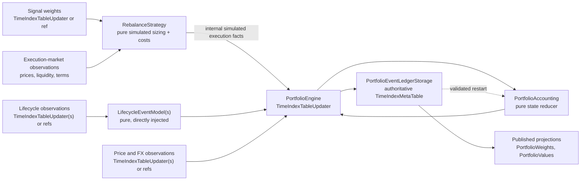

# Position-Aware Portfolio Accounting

Every portfolio keeps a position-aware ledger
([ADR 0065](../../../ADR/0065-every-portfolio-keeps-a-ledger.md)). The ledger
tracks instrument quantities, currency balances, receivables, payables, and
position-driven cash flows: dividends, funding, coupons, exercise, expiry,
settlement, and user-defined lifecycle economics. `PortfolioEngine` books every
portfolio, and the weights and values a portfolio publishes are projections of its
ledger (`PortfolioWeights`, `PortfolioValues`).

!!! note "Current implementation status"

    The canonical ledger, reference reducer, coordinated signal-to-strategy
    execution simulation, explicit instrument sizing and settlement terms,
    strategy-owned execution costs, dividend recognition and settlement,
    explicit price/FX valuation, ledger restart, read projections, the published
    weights and values projections, storage schemas, and their migrations are
    implemented. Issue #11 removed the erroneous external execution ingress;
    there is no replay lane or fallback. Correction-tail publication, optimized
    reducer parity, publication of the state and cash-flow projections, and
    option/bond acceptance fixtures remain implementation work inside
    `msm_portfolios`. There is no `mainsequence-sdk` blocker.

The architectural contract is recorded in
[ADR 0042](../../../ADR/0042-position-cash-flow-portfolio-accounting.md),
[ADR 0058](../../../ADR/0058-trade-at-the-next-observed-price.md) and ADR 0065.

## Architecture And Ownership



The responsibilities are strict:

- `PortfolioEngine` owns dependencies, source loading, orchestration, canonical
  validation, and publication of one authoritative table.
- A Portfolio is a backtest model with no Account, custody, broker orders,
  trades, fills, or actual account holdings.
- `PortfolioAccounting` is an in-memory deterministic reducer. It is not a
  `TimeIndexMetaTable`, updater, or extension point.
- `LifecycleEventModel` implementations turn declared observations into typed,
  columnar event records. They do not write storage or mutate the reducer.
- `PositionValuationModel` values the complete position/cash/obligation state at
  an economic timestamp using explicit observations.
- `PortfolioEventLedgerStorage` is restart authority. State, cash-flow, weight,
  and value tables are rebuildable projections.
- All simulated accounting and deterministic restart behavior belongs to
  `msm_portfolios`. The existing `metatables` updater, MetaTable, and migration
  contracts are sufficient.

## What A Portfolio Books

| Requirement | How |
| --- | --- |
| Quantities, currency cash, receivables, payables, or lifecycle cash flows | `PortfolioEngine`, for every portfolio |
| Signal targets converted into simulated quantities and costs | The strategy's recorded fills, booked by `PortfolioEngine` |
| Execution costs | The strategy's `execution_cost_model_instances` |
| User-defined position-dependent economics | Inject a `LifecycleEventModel` |

Broker executions, account trades, custody holdings, and actual cash are not a
Portfolio path. They belong to the account domain even when an Account uses a
Portfolio as allocation intent.

`PortfolioBuildConfiguration.accounting_configuration` is required.

## Target Configuration

`PortfolioAccountingConfiguration` is hash-bearing. Every value that can change
economic events, state, or valuation belongs in this configuration or in a
versioned model configuration.

```text
PortfolioBuildConfiguration
  valuation_source_instance        prices the rebalance fills at and the ledger values at
  valuation_column                 the source column that holds the price
  valuation_asset_identifier       the portfolio's currency (ADR 0059)
  fx_source_instance               optional; prices in another currency
  backtesting_weights_configuration
    signal_weights_instance
    rebalance_strategy_instance
  accounting_configuration
    initial_nav
    initial_state_time_index
    position_valuation_model_instance
    lifecycle_event_model_instances
```

The signal and `RebalanceStrategy` already owned by
`BacktestingWeightsConfig` are the only execution decision path. Accounting does
not accept an execution source, Account, broker, order, trade, fill, or holdings
dependency. The removed external-execution field is rejected as an unknown
configuration key; it has no alias or compatibility fallback.

Configure position sizing, settlement, and execution-time costs on the rebalance
strategy. A strategy that states no `execution_model_instance` trades with the
default model (ADR 0065, decision 11): every asset its fills trade, in fractional
units (`quantity_step=None`), with multiplier 1, `market_value_weight` and cash
settlement, quoted in the currency of the asset's valuation rows. State an
execution model to change that:

```python
from msm_portfolios.rebalance_strategy import (
    ImmediateSignal,
    InstrumentExecutionSpec,
    ProportionalExecutionCostModel,
    TargetWeightExecutionModel,
)

strategy = ImmediateSignal(
    calendar_events_instance=calendar_events,  # a PortfolioCalendarEvents for XNYS
    calendar_identifier="XNYS",
    execution_model_instance=TargetWeightExecutionModel(
        instrument_specs=(
            InstrumentExecutionSpec(
                asset_identifier="STOCK-EUR",
                quantity_unit="shares",
                target_measure="market_value_weight",
                contract_multiplier=1.0,
                quantity_step=1.0,
                price_asset_identifier="EUR",
                settlement_style="cash",
                terms_version="stock-v1",
            ),
        )
    ),
    execution_cost_model_instances=(
        ProportionalExecutionCostModel(rate=0.001),
    ),
)
```

`PortfolioEngine` depends on the portfolio's `PortfolioRebalance`
(`portfolio_rebalance_instance`) and books exactly the fills it recorded: time,
asset and observed price ([ADR 0058](../../../ADR/0058-trade-at-the-next-observed-price.md)).
A rebalance fixes every asset's share count once, at its decision: target weight
x NAV / price, with the NAV and the prices last observed strictly before its
earliest moment, the same set for all assets. Each asset then fills that count at
its own next observed price; the weight it reaches comes from the fill. The engine
builds no schedule of its own and looks up no mark for a fill. The decision's NAV,
prices and FX rates are the last observed before the earliest moment, however old:
a decision after a weekend reads Friday's close. Strategies with their own bars
are sized at each fill.

A recorded fill that trades part of its order (a cash-limited buy) trades the
same fraction of the ledger's own open order, rounded down to the lot step, and
a cancellation is recorded as execution progress with the reason in its
`strategy_state`. The ledger cuts only its own shortfalls: lot rounding,
execution costs and lifecycle cash can leave it with less cash than the
rebalance's book. Cash in every currency is counted in the portfolio's currency
at the last observed FX rate, and the buys share what is left down to the
execution policy's floor (no negative cash, a fraction of NAV, or a fixed amount),
pro rata; the progress record carries `ledger_cut` (`quantity`, `reason`)
([ADR 0059](../../../ADR/0059-portfolio-currency-fx-and-drifting-weights.md)).

The ledger reads the portfolio's valuation source and FX source from the build
configuration (`valuation_source_instance` with `valuation_column`, and
`fx_source_instance`); `MarketPriceValuationModel` declares neither of its own.

`TargetWeightExecutionModel` sizes every compatible Asset in one vectorized
timestamp batch from the immutable post-lifecycle state and NAV. Every Asset
with nonzero desired exposure or a position to close requires an
`InstrumentExecutionSpec`; an unchanged zero target is not economically
required. An explicit model's unit, multiplier, lot step, quote Asset, target
measure, and settlement style are never guessed; `quantity_step=None` trades
fractional quantities.
For each rebalance timestamp the strategy receives the signal targets, desired
and current exposures, immutable positions, free settled balances by currency,
post-lifecycle NAV, price/FX observations, canonical valuation references, and
the prior execution-progress state. Assets are partitioned by a stable
vectorization signature—target measure, unit, quote Asset, multiplier, lot step,
terms version, and settlement style—then each compatible partition is sized and
costed as one vector.
`settlement_style="cash"` posts trade consideration. For a linear perpetual
whose position has zero fair value between variation-margin events,
`settlement_style="variation_margin"` changes contract quantity without
deducting full notional cash. Funding remains a lifecycle event.

Before publishing, the referenced `PortfolioTable` row and every Asset used by
positions, cash, prices, or FX must already exist. Persisted Asset dimensions use
canonical `asset_identifier` values that reference
`AssetTable.unique_identifier`; there is no `unique_identifier` input fallback.

### Initial State

The current opening-state contract is deliberately narrow:

- `initial_nav` must be finite and strictly positive.
- `initial_state_time_index` must be timezone-aware.
- The opening book is exactly `initial_nav` units of settled cash in the
  portfolio's currency, `PortfolioBuildConfiguration.valuation_asset_identifier`.
- Restart does not create another opening contribution. It reconstructs state
  from the canonical ledger.

Supplying arbitrary opening positions or obligations is not currently a public
contract.

## Required Input Contracts

All timestamps are economic UTC timestamps. Inputs retain their truthful grains;
the engine does not reshape unrelated sources into one artificial index.

### Internal Simulated Execution Facts

The configured `RebalanceStrategy` produces a batch of deterministic simulated
execution facts from signal targets, market observations, and the
post-lifecycle/pre-execution accounting state. This batch is an internal typed
boundary to `PortfolioAccounting`; it is not an upstream table or broker feed.
One row represents one simulated signed execution fact.

| Field | Required | Meaning |
| --- | --- | --- |
| `time_index` | Yes | Economic execution time |
| `execution_identifier` | Yes | Stable simulated execution identity |
| `source_revision` | Yes | Deterministic revision of the signal, observations, terms, strategy, and input state |
| `asset_identifier` | Yes | Executed instrument Asset |
| `quantity_delta` | Yes | Signed executed quantity; buy positive, sell negative |
| `quantity_unit` | Yes | Explicit unit such as `shares` or `contracts` |
| `execution_price` | Yes | Price per declared quantity unit |
| `price_asset_identifier` | Yes | Asset in which the execution price is quoted |
| `position_identifier` | No | Stable position state identity; defaults to the Asset identifier |
| `observed_at` | Yes | Availability time of the selected execution mark |

The economic identity `(execution_identifier, source_revision)` must be unique.
Settlement and cost legs are explicit. The engine must not infer spot cash
consideration, futures settlement, multipliers, or inverse-contract behavior
from an Asset type or ticker.

### Price Observations

`PortfolioEngine` reads the portfolio's valuation source, for the assets its fills
trade, and gives `MarketPriceValuationModel` rows of grain
`(time_index, asset_identifier)` with:

| Field | Meaning |
| --- | --- |
| `price` | The source's `valuation_column` |
| `price_asset_identifier` | The source's column of that name; without one, the portfolio's currency |
| `source_revision` | The source's column of that name; without one, computed from the row's time, asset and price |

The most recent observation at or before the accounting timestamp is selected,
however old. Past `maximum_staleness` it is marked stale: the valuation reference
carries `"stale": "true"`, `ValuationResult.stale_sources` lists it, and the event's
`valuation_summary` row names it in its `extension_payload` under
`"stale_sources"`. A held position with no observation at all at or before the
timestamp fails the event. FX rates follow the same rule.

An event that changes a position also records, in its summary's
`extension_payload`, each asset's position value before and after the event
(`"position_values_before"`, `"position_values"`, in the portfolio's currency).
The published weights are those values over the NAV.

### Price Level And Asset Events

The source states which events its prices include: `events_in_price` on its
configuration (`InterpolatedPricesConfig.events_in_price`). `"adjusted"`, the
default, includes every event of the asset; a tuple names exactly the event types
the prices include, `()` for unadjusted prices. A source given as a
`TimeIndexTableRef` is adjusted (`msm_portfolios.accounting.events`).

An asset type lists the events its assets can have (`AssetType.event_types`), and
a lifecycle model the event types it books (`booked_event_types`):

- On prices that do not include an event, `PortfolioEngine` refuses to book a
  portfolio that holds or buys an asset whose type lists that event while no model
  books it. The error names each asset and event. An asset Markets does not know is
  refused too. On adjusted prices nothing is read.
- A build configuration whose lifecycle model books an event its source's prices
  include is refused: the event would be counted twice. `DividendCashFlowModel`
  therefore needs a source that states its prices exclude dividends.

### FX Observations

FX grain is
`(time_index, base_asset_identifier, quote_asset_identifier)` with:

| Field | Meaning |
| --- | --- |
| `rate` | Units of quote Asset per one unit of base Asset |
| `source_revision` | Reproducible observation revision |

For a USD portfolio, `(EUR, USD, 1.10)` means one EUR is worth 1.10 USD. The
rate must be finite and strictly positive. The engine requires the exact
base-to-valuation pair; it does not infer or invert another pair. Valuation-Asset
cash uses a rate of one and needs no FX row.

### Dividend Observations

The built-in `DividendCashFlowModel` accepts grain
`(time_index, source_event_identifier, source_revision)` with:

| Field | Meaning |
| --- | --- |
| `observed_at` | When this source revision became available |
| `asset_identifier` | Instrument whose holders may be entitled |
| `entitlement_time_index` | Economic cutoff used to snapshot eligible quantity |
| `payment_time_index` | Economic settlement time |
| `amount_per_unit` | Signed dividend amount per eligible instrument unit |
| `settlement_asset_identifier` | Asset delivered at payment |

One observation expands into two linked transitions:

1. At entitlement, eligible quantity creates a receivable and recognizes income.
2. At payment, the receivable is reduced and settled cash increases.

The receivable survives sale of the originating shares. A buyer entering after
the entitlement cutoff receives nothing. Payment exchanges one balance for
another and therefore does not recognize the income a second time.

## Small EUR Dividend / USD Valuation Example

Run the complete offline fixture without backend writes:

```bash
uv run --extra portfolios python \
  examples/msm_portfolios/portfolio_cashflows_and_fx_valuation_example.py
```

The fixture produces this economic sequence:

| Time | Event | Result |
| --- | --- | --- |
| 2026-01-01 | Opening state | USD 1,000 settled cash |
| 2026-01-02 | Buy | +10 `STOCK-EUR`, EUR -500 cash |
| 2026-01-03 | Entitlement | EUR +10 receivable; USD +11 recognized P&L at EUR/USD 1.10 |
| 2026-01-04 | Sell | Position closes; receivable remains |
| 2026-01-05 | Settlement | EUR +10 cash and EUR -10 receivable; zero additional P&L |

The example prints event-level USD NAV/P&L, ending positions, obligations and
currency balances, completed cash-flow rows, and normalized USD portfolio
values. It also exposes the frames through `build_example()` for tests.

## Linear Perpetual / Funding Example

Run the variation-margin fixture:

```bash
uv run --extra portfolios python \
  examples/msm_portfolios/portfolio_perpetual_funding_example.py
```

The first signal targets 100% notional exposure at USD 100 and creates ten
contracts without a USD 1,000 trade-consideration debit; its one-percent
commission reduces NAV to USD 990 exactly once. Then a vectorized
`PositionCashFlowModel` applies USD 100 of funding in `pre_execution`. The next
signal comes after it and is sized at its decision from the resulting USD 890
NAV; its fill changes the position to eight contracts and applies a USD 2
commission once. A
second funding event changes cash and NAV with no rebalance. The fixture uses a
custom `PositionValuationModel` because a variation-margined contract has
different value semantics from a cash-settled share; settlement style and
valuation model must agree.

## Economic Ordering

The reducer scans actual economic timestamps from signal/strategy observations,
lifecycle events, and requested valuation observations. It never creates a
generic frequency grid or uses job time as an economic timestamp.

Within one timestamp, current processing is:

1. lifecycle events in `pre_execution`;
2. the configured rebalance strategy emits and accounting applies internal
   simulated execution facts in `execution`;
3. lifecycle events in `post_execution`; and
4. an optional valuation marker.

Lifecycle models are ordered by explicit `economic_ordering_priority` and then
stable model identifier. Events whose results depend on each other require an
explicit causal ordering contract; the complete causal-DAG/atomic-group engine
is still pending and must not be represented as already implemented.

`historical_information_policy.mode="as_known"` is the implemented mode. A
candidate whose `observed_at` is later than its economic `time_index` is rejected
to prevent look-ahead. Corrected-history calculation is intentionally rejected
until deterministic correction-tail publication exists.

## Canonical Event Ledger

`PortfolioEventLedgerStorage` is a `PlatformTimeIndexMetaTable` with grain:

```text
(time_index, portfolio_identifier, event_identifier,
 event_revision, record_identifier)
```

An event is one indivisible state transition represented by one or more typed
economic records plus exactly one `valuation_summary` record.

Supported record kinds are:

| Record kind | Meaning |
| --- | --- |
| `position_delta` | Signed change to an instrument position |
| `cash_delta` | Signed settled or restricted cash movement |
| `obligation_delta` | Signed receivable, payable, or deliverable change |
| `cost` | Execution-time cost posting |
| `lifecycle_state` | Versioned model-owned state transition |
| `execution_progress` | Execution simulation progress fact |
| `event_marker` | Economic event with no direct balance posting |
| `valuation_summary` | One event-level NAV-before, NAV-after, and recognized-P&L summary |

Important envelope and integrity fields include:

- `event_identifier`: stable economic identity derived from portfolio, producer,
  source, and local event identity;
- `event_revision`: deterministic revision derived from source/model revision and
  input state;
- `event_sequence` and `record_sequence`: resolved processing order;
- `event_record_count` and `event_digest`: proof that the complete event group is
  present and unchanged;
- `input_state_identifier` and `ledger_state_identifier`: state-chain lineage;
- `source_identifier`, `source_revision`, `model_identifier`, and
  `model_version`: reproducibility lineage; and
- `valuation_references`: canonical references to price and FX observations.

`recognized_pnl`, `nav_before`, and `nav_after` belong to the summary record.
A cash movement is not automatically P&L: a trade exchanges cash for an
instrument, and dividend payment exchanges a receivable for cash.

Database uniqueness covers the full time-first grain. TimescaleDB requires its
partition column in every unique key. The canonical normalizer, publication
comparison, restart, and projections additionally reject duplicate economic
record identities across timestamps and event revisions split across times.
Do not publish ledger rows through raw SQL: it bypasses these accounting guards.

## Retry, Restart, And Corrections

Exact retries are idempotent. Reprocessing the same economic event with the same
source revision produces the same identity and does not apply the balance change
twice. Before publication, existing and calculated event digests are compared.

`PortfolioAccounting.from_ledger(...)` reconstructs positions, cash,
obligations, execution progress, applied revisions, latest NAV, and event
sequence from a complete active ledger. It validates:

- one portfolio identity;
- unique economic record identities independent of timestamp, and one timestamp
  per event revision;
- contiguous event and record sequences;
- record counts and event digests;
- exactly one valuation summary per event;
- the input/output state-identifier chain; and
- the configured opening timestamp, currency, and NAV.

Changed or deleted source revisions currently stop with an explicit tail-replay
error. They are never ignored or applied on top of the old state. Appending
superseding/cancellation revisions and publishing the corrected portfolio tail
remain `msm_portfolios` work; no SDK or MetaTables client feature is needed.

## Read Projections

The public pure projections consume only the ledger:

```python
from msm_portfolios.accounting import (
    project_cash_flows,
    project_portfolio_values,
    project_portfolio_weights,
    project_state,
)

state = project_state(ledger)
cash_flows = project_cash_flows(ledger)
values = project_portfolio_values(ledger, initial_nav=1_000_000.0)
weights = project_portfolio_weights(ledger)
```

- `project_state` returns end-of-timestamp position, cash, and obligation
  quantities by stable `state_identifier`. It preserves explicit zero rows with
  `is_closed=True`.
- `project_cash_flows` returns completed `cash_delta` and `cost` records only.
  Future payments remain obligations and do not appear as cash.
- `project_portfolio_values` selects the final summary per economic timestamp and
  derives normalized `close = nav_after / initial_nav`, linked returns, and
  `valuation_stale` from the summary's stale sources. `PortfolioValues` publishes
  it to `PortfolioValuesSeries`.
- `project_portfolio_weights` returns, for each event that changed a position, the
  weight of each asset it changed: its value over the NAV after the event, before
  it, and the price the event booked it at. When several events at one time change
  an asset, the weight is the last one's and `weight_before` the first one's.
  `PortfolioWeights` publishes it to `PortfolioWeightsSeries`.

`PortfolioStateStorage` and `PortfolioCashFlowsStorage` are additive schemas
installed by the ms-markets migration provider. Nothing writes them yet; callers
must not describe the schemas as independent accounting authorities.

## User-Defined Cash Flows And Lifecycle Events

Users extend lifecycle economics by directly injecting a module-level,
importable `LifecycleEventModel`. There is no string registry or built-in
fallback.

Use `PositionCashFlowModel` when every candidate produces one settled cash
posting. Override its vectorized `calculate_cash_deltas(...)` method. Use the
full `LifecycleEventModel` when an event also changes positions, obligations,
deliverables, or model-owned state.

The supported full-model hooks are:

```text
declared_dependencies()
required_input_contracts()
dependency_window(...)
alignment_contracts()
lifecycle_state_contract()
select_event_candidates(...)
vectorization_keys(...)
build_event_batch(...)
```

Models receive validated source batches and an immutable accounting-state view.
They return a flat `EventBatch` with NumPy-compatible columns and event offsets.
They must not query hidden data, read wall-clock time, mutate reducer state, or
write any ledger/projection table.

Run the custom vectorized example:

```bash
uv run --extra portfolios python \
  examples/msm_portfolios/portfolio_custom_cashflow_model_example.py
```

It defines a user-owned EUR usage royalty outside `msm_portfolios`, injects it
directly, processes two compatible source events in one vectorized model call,
and values their effect in USD using the shared FX observations.

## Failure Semantics

Accounting mode is strict. Common failures mean:

| Error | Cause |
| --- | --- |
| No observed valuation price | A held position has no mark at or before the timestamp |
| Missing explicit FX | A non-valuation Asset has no direct FX observation into the valuation Asset |
| Duplicate grain coordinates | A declared source contains more than one row at its stated grain |
| Observation would cause look-ahead | `observed_at` is later than the economic event in `as_known` mode |
| Broken event digest or state chain | Ledger records are incomplete, modified, or incorrectly ordered |
| Corrected source revision requires tail replay | A source changed and correction publication is not yet implemented |
| Assets with events nothing books | On prices that do not include an event, a held or bought asset's type lists it and no lifecycle model books it |
| An event would be counted twice | A lifecycle model books an event the valuation source's prices include |

The engine does not convert any of these conditions into a zero cash flow,
stale valuation, or inverse FX guess.

## Migration And Validation

The ms-markets migration provider creates the canonical ledger and rebuildable
state/cash-flow schemas. Hosted environments receive them only from the
ms-markets deployment's `migrate-markets` Job, which runs before the Markets API
rolls out; applications that use portfolio accounting do not apply the
ms-markets provider themselves. During ms-markets development, apply it to the
local runtime with
`metatables --local migrations upgrade --provider msm_migrations:migration head`
before runtime attachment.

Revision `0019` repairs the ledger's incompatible non-time unique constraint
without deleting rows or changing the full-grain unique index. It also recovers
an environment where `0018` committed but ledger hypertable finalization failed:
the normal deployment Job applies `0019` and reconciles catalog finalization.
After hypertable conversion, downgrading to the incompatible `0018` constraint
is not supported by TimescaleDB; use a forward migration instead.

For changes to this accounting surface, run at least:

```bash
uv run --extra portfolios --extra dev ruff check \
  src/msm_portfolios/accounting \
  src/msm_portfolios/time_index/portfolios \
  examples/msm_portfolios \
  tests/msm_portfolios/accounting

uv run --extra portfolios --extra dev pytest \
  tests/msm_portfolios/accounting/test_accounting.py

uv run --extra portfolios --extra dev mkdocs build --strict \
  --site-dir /private/tmp/msmarkets-docs-site
```

CI runs the complete repository test suite on every push.
